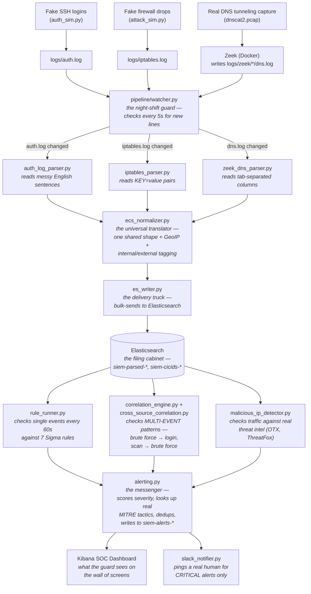

# How Your SIEM Actually Works: A Complete Guide

## Part 1: The Big Picture

### What is a SIEM, really?

Imagine a security guard sitting in front of a wall of TV screens in an office building. Each screen shows a different door, hallway, or entrance. The guard's job is simple to describe but hard to do well: **watch everything, and if something looks wrong, ring an alarm and explain why.**

A SIEM (Security Information and Event Management system) is that guard, except instead of TV screens, it watches **logs** — records of things happening on computers and networks. Someone tries to log in. A firewall blocks a connection. A new user account gets created. Every one of these events is like a little note landing on the guard's desk.

The problem a real guard would have with thousands of notes per second is exactly the problem a SIEM solves:

- **It can't read every note by hand.** So it needs a fast, organized way to file every note so it can be searched later. (This is what Elasticsearch does — it's the guard's filing cabinet.)
- **Different doors write notes in different handwriting.** A Linux server's login log looks nothing like a firewall's log, which looks nothing like a web server's log. Someone has to translate all of these into one consistent format before the guard can compare them side by side. (This is what our **parsers** and the **ECS normalizer** do.)
- **One note rarely tells the whole story.** Eleven failed logins from the same address, followed by one success, is a very different story than eleven random failed logins from eleven different people. The guard needs to notice _patterns_, not just individual notes. (This is what our **Sigma rules** and **correlation engines** do.)
- **Knowing the story isn't enough — someone has to actually get told.** A guard who notices a break-in but never presses the alarm button is useless. (This is what our **alerting system** and **Slack notifications** do.)

Everything in this project is built to do one of those four jobs: **collect**, **translate**, **notice patterns**, or **tell someone**.

---

### The 10,000-Foot Map

Here's the whole system in one picture — every log's journey, from the moment something happens on a (simulated) computer to the moment a real human gets pinged about it.



Every single box in this diagram is a real file you built, and every arrow is a real connection you can trace in the code. The rest of this guide walks through each box in detail, then follows one real event through the entire chain from top to bottom.

> **Note:** this diagram uses [Mermaid](https://mermaid.js.org/) syntax. It renders automatically on GitHub, in most modern markdown viewers, and in VS Code with the "Markdown Preview Mermaid Support" extension. If your viewer doesn't support it, you can paste the code block into [mermaid.live](https://mermaid.live/) to see it rendered.

---
## Part 2: Zero-to-Hero Setup Guide

This section assumes you have **nothing** set up yet — a fresh Mac, an empty folder, and this repository. Follow it top to bottom and you'll end with a fully running SIEM: ingesting data, detecting attacks, and alerting on them.

---

### Step 0: What you need before you start

|Tool|Why|Check you have it|
|---|---|---|
|**Docker Desktop**|Runs Elasticsearch, Kibana, Logstash, Filebeat as isolated containers|`docker compose version`|
|**Python 3.10+**|Runs every parser, detector, and generator script|`python3 --version`|
|**Git**|Version control, already initialized in this repo|`git --version`|
|**A free AlienVault OTX account**|Real threat intel feed #1|Sign up at otx.alienvault.com|
|**A free Abuse.ch account**|Real threat intel feed #2 (ThreatFox)|Sign up at auth.abuse.ch|
|**(Optional) A Slack workspace**|For real-time critical alert notifications|Any workspace you can add an app to|

If `docker compose version` or `python3 --version` fail, install Docker Desktop and Python from their official sites before continuing — everything else in this guide assumes both work.

---

### Step 1: Get the project onto your machine

```bash
git clone <your-repo-url> SIEM
cd SIEM
```

If you're picking up an existing clone instead of starting fresh, just `cd` into it.

---

### Step 2: Start the ELK stack

The whole ingestion backbone — Elasticsearch (the filing cabinet), Logstash (the raw-data pipe), Kibana (the dashboard), Filebeat (the CICIDS file watcher) — is defined in `docker-compose.yml` and starts with one command:

```bash
docker compose up -d
```

First run downloads ~3 container images and can take a few minutes. Check on it:

```bash
docker compose ps
```

Wait until `es01` shows `(healthy)` before moving on — nothing else works until Elasticsearch is actually up.

**Common snag:** if Elasticsearch crashes immediately with a `max virtual memory areas` error (mostly a Linux thing, rare on Mac), run:

```bash
sudo sysctl -w vm.max_map_count=262144
```

**Verify it's really working:**

```bash
curl http://localhost:9200
```

You should get back a JSON blob with a `cluster_name`. If you do, the filing cabinet is open for business.

---

### Step 3: Set up your Python environment

Every script in this project — parsers, detectors, generators — runs through one shared virtual environment so its dependencies don't collide with anything else on your machine.

```bash
python3 -m venv venv
```

**On Mac/Linux (bash/zsh):**

```bash
source venv/bin/activate
```

Once activated, your terminal prompt should show `(venv)` at the start of the line — that's your confirmation every `python3`/`pip` command from here on uses this isolated environment.

Install the dependencies:

```bash
pip install elasticsearch==8.14.0 pandas requests OTXv2 python-dotenv pytest
```

> **Why `elasticsearch==8.14.0` specifically, not the latest version?** Our Docker Elasticsearch container runs version 8.14.3. The Python `elasticsearch` library's newest releases (version 9+) speak a slightly different protocol dialect that our 8.x server rejects. Pinning to 8.x keeps them compatible.

---

### Step 4: Set up your secrets file

Several parts of this project talk to real external services (threat intel feeds, Slack) that need API keys. These never get committed to git — they live in a local `.env` file only.

```bash
touch .env
```

Add these lines, replacing each placeholder with your real key (get OTX and ThreatFox keys from the accounts you created in Step 0; the Slack webhook is optional and covered fully in Part 9's environment variable reference):

```
OTX_API_KEY=your_real_otx_key
THREATFOX_AUTH_KEY=your_real_threatfox_key
SLACK_WEBHOOK_URL=your_real_slack_webhook_url
```

Confirm it's correctly excluded from git (it should already be, but double-check):

```bash
git check-ignore .env
```

If that prints `.env`, you're safe — it's ignored and will never be committed.

---

### Step 5: Register the index templates

Elasticsearch needs to know, in advance, what _type_ each field should be (an IP address field, a number field, a plain keyword) — otherwise it guesses, and guesses wrong often enough to break dashboards later. Two templates need registering, once each, before any real data flows in:

```bash
python3 pipeline/index_template.py
python3 pipeline/alerts_index_template.py
```

Both should print `{'acknowledged': True}`.

---

### Step 6: Build the MITRE ATT&CK mapping

This downloads MITRE's real, official technique-to-tactic data once (~50MB) and saves a small local lookup file — this is what lets alerts show real tactics like "Credential Access," not just raw technique IDs.

```bash
python3 pipeline/build_mitre_mapping.py
```

You should see `Built mapping for 637 techniques -> pipeline/mitre_technique_tactic_map.json`. This file is small and already committed to the repo, so you generally only need to run this once, ever (or again later if you want to refresh against a newer ATT&CK release).

---

### Step 7: Fetch real threat intelligence

Pull down current malicious IPs from both feeds:

```bash
python3 pipeline/otx_client.py
python3 pipeline/threatfox_client.py
```

Each caches its results locally in `pipeline/.state/`. These caches are what `malicious_ip_detector.py` checks live traffic against.

---

### Step 8: Convert your Sigma rules into real Elasticsearch queries

```bash
python3 pipeline/sigma_converter.py
```

This reads every `.yml` file in `rules/`, turns each into a real Lucene query Elasticsearch understands, and saves them to `pipeline/compiled_rules.json`. You should see 7 rules convert successfully (the 8th, the correlation rule, is intentionally skipped — it's handled by real Python logic instead, not a converted query).

---

### Step 9: Start generating and ingesting data

Two background processes need to run continuously: one generating realistic fake activity, one watching for new log lines and shipping them into Elasticsearch.

The easiest way — use the helper script:

```bash
./start_project.sh
```

This relaunches Docker (if needed), starts all 4 containers, waits for Elasticsearch to be healthy, then starts both background processes for you, saving their process IDs so you can check on them later.

**To verify by hand instead:**

```bash
nohup python3 -u generators/auth_sim.py > logs/auth_sim_output.log 2>&1 &
echo $! > logs/auth_sim.pid

nohup python3 -u pipeline/watcher.py > logs/watcher_output.log 2>&1 &
echo $! > logs/watcher.pid
```

**Check both are actually running:**

```bash
ps aux | grep -E "auth_sim.py|watcher.py"
```

You should see exactly 2 real Python processes (plus the harmless `grep` line matching itself). If you ever see more than 2, kill the duplicates — this project has bitten us before when multiple copies of the same process race each other.

---

### Step 10: Verify everything end to end

Run the full validation script — it fires real attack simulations and confirms every detection actually catches them:

```bash
python3 pipeline/validate_all_rules.py
```

You're looking for:

```
RESULT: 10/10 detections fired successfully
```

If you see fewer than 10/10, don't panic — Part 6 (Troubleshooting Journal) walks through the exact real bugs that can cause this and how each one was actually diagnosed and fixed.

---

### Step 11: Open Kibana and look around

1. Go to `http://localhost:5601`
2. ☰ menu → **Stack Management** → **Data Views** → confirm `siem-parsed-auth`, `siem-parsed-iptables`, `siem-alerts` (and others) exist
3. ☰ menu → **Dashboard** → open your saved SOC dashboard
4. You should see real charts populated with real data from the steps above

---

### Step 12: (Optional) Run the full attack demo

To see the whole system work end to end, narrated:

```bash
python3 pipeline/demo_attack.py
```

Watch it fire a chained attack, a known-malicious-IP connection, and confirm each gets detected live — check your Kibana dashboard and Slack channel (if configured) as it runs.

---

### When you're done for the day

```bash
./stop_project.sh
```

This stops the background processes and fully quits Docker Desktop, freeing up your Mac's memory. Nothing gets deleted — your data, code, and configuration are all still there next time.

```bash
./start_project.sh
```

...brings it all back exactly where you left off.

---
## Part 3: The Cast of Characters

Every file in this project has a job. Some watch, some translate, some investigate, some deliver messages. This section introduces each one like a character in a story — what they do, who they depend on, and what happens if they stop showing up for work.

---

### 🚪 The Ingest Crew — _getting raw data in the door_

#### `docker-compose.yml` — **The Building Manager**

**Role:** Defines the entire building — 4 rooms (containers), how they're wired together, and what happens when the building opens. **Responsibilities:** Starts Elasticsearch, Logstash, Kibana, and Filebeat together; connects them on a shared private network (`siem-net`); mounts your local folders so containers can see your files. **Depends on:** Docker Desktop being installed and running. **What breaks if it dies:** Nothing else in the project can run — no filing cabinet, no dashboard, no pipe. This is the foundation everything else stands on.

#### `filebeat/filebeat.yml` — **The Junior Mail Clerk**

**Role:** Watches one specific folder (`logs/cicids/*.json`) and hands anything new to Logstash. **Responsibilities:** Only watches CICIDS data now — the Python watcher (`pipeline/watcher.py`) took over auth/iptables/Zeek duties to avoid double-processing the same files. **Depends on:** Logstash being reachable on port 5044. **What breaks if it dies:** New CICIDS data stops flowing in. Everything else (auth, iptables, Zeek, alerts) is unaffected — those go through the Python pipeline instead.

#### `logstash/pipeline/siem.conf` — **The Front-Desk Receptionist**

**Role:** Receives whatever Filebeat hands over, tags it with a source name and today's date, and files it into the right Elasticsearch index. Also fingerprints each raw line into a stable ID so re-sending the same line twice doesn't create a duplicate. **Depends on:** Filebeat (upstream), Elasticsearch (downstream). **What breaks if it dies:** CICIDS ingestion stops (same effect as Filebeat dying — they're a matched pair).

#### `logstash/config/logstash.yml` — **The Receptionist's Rulebook**

**Role:** Basic operating settings for Logstash itself (network binding, monitoring). Rarely touched after initial setup. **What breaks if it dies:** Logstash won't start at all — but this file almost never needs to change once it works.

---

### 🎭 The Generators — _creating realistic activity to detect_

#### `generators/auth_sim.py` — **The Office Extra**

**Role:** Plays the part of a normal, busy office — employees logging in, occasionally failing a password, occasionally creating an account or running `sudo`. Runs forever in the background. **Responsibilities:** Writes realistic Linux syslog-format lines to `logs/auth.log`; picks IPs from a wide internal range specifically to avoid accidentally looking like an attack (see Part 6, the false-positive bug). **Depends on:** Nothing — pure Python, writes straight to a file. **What breaks if it dies:** No new background "office noise" — your dashboards go quiet, but nothing crashes. Detection logic still works fine on whatever data already exists.

#### `generators/iptables_sim.py` — **The Bored Firewall**

**Role:** Writes realistic firewall DROP/ACCEPT log lines, simulating routine internet background noise (scanners probing common ports). **What breaks if it dies:** Same as above — quieter data, nothing broken.

#### `generators/attack_sim.py` — **The Stunt Double**

**Role:** On command, performs a _deliberate_, coherent attack — a real brute-force sequence (many failures, one success) or a real port-scan burst, from one consistent attacker IP. This is what actually proves your detection rules work, since the background noise never naturally produces a clean attack pattern. **Depends on:** Writes to the same `logs/auth.log` and `logs/iptables.log` the real watcher is already monitoring. **What breaks if it dies:** You lose your on-demand "prove it works" button — background noise alone won't reliably trigger the correlation rules.

#### `generators/cicids_loader.py` — **The Historian**

**Role:** Loads real, labeled attack data from the CICIDS-2017 research dataset (port scans, web attacks, infiltration) into `logs/cicids/*.json`, so the project has genuine historical attack traffic, not just simulated data. **Depends on:** The raw CSV files being present in `datasets/TrafficLabelling/`. **What breaks if it dies:** You can't load additional CICIDS files, but already-loaded data is unaffected.

#### `pipeline/demo_attack.py` — **The Tour Guide**

**Role:** Runs a full, narrated, multi-scenario demo — fires real attacks, waits for ingestion, and checks each detection engine live, printing a clear pass/fail story. This is what you'd run in an interview. **Depends on:** `attack_sim.py`, `otx_client.py`, and all 3 detection engines being importable and working. **What breaks if it dies:** You'd fall back to running each piece manually — everything still works, just less polished to demo.

---

### 🗣️ The Translators — _turning messy formats into something readable_

#### `parsers/auth_log_parser.py` — **The English Interpreter**

**Role:** Reads free-text Linux syslog lines (`Failed password for admin from 1.2.3.4...`) and pulls out structured meaning using regular expressions. Handles 3 different sentence patterns: SSH logins, account creation, sudo commands. **Depends on:** `pipeline/es_writer.py` (to send parsed events), `parsers/ecs_normalizer.py` (to standardize the shape before sending). **What breaks if it dies:** No new auth.log data gets ingested at all — SSH/account/sudo detections go stale.

#### `parsers/iptables_parser.py` — **The Form Reader**

**Role:** Reads `KEY=value KEY=value` formatted firewall logs — an easier format than free text, since every field is explicitly labeled. **What breaks if it dies:** No new firewall data — port-scan and cross-source detections go stale.

#### `parsers/zeek_conn_parser.py` — **The Spreadsheet Reader**

**Role:** Reads Zeek's tab-separated `conn.log`, using the file's own `#fields` header line to know what each column means (rather than hardcoding column positions, which would break if Zeek's config ever changed). **What breaks if it dies:** Zeek network-connection data stops flowing.

#### `parsers/zeek_dns_parser.py` — **The DNS Detective**

**Role:** Same spreadsheet-reading trick as above, but for DNS query logs specifically — also calculates subdomain length for each query, which is the actual signal our DNS tunneling detection rule looks for. **What breaks if it dies:** DNS tunneling detection has no new data to check.

---

### 🌐 The Standardizer — _making everyone speak the same language_

#### `parsers/ecs_normalizer.py` — **The Universal Translator**

**Role:** The single most important shape-shifting step in the whole pipeline. Every parser hands it a flat dictionary with dotted keys (`"source.ip": "1.2.3.4"`); it turns that into a real nested structure (`{"source": {"ip": "1.2.3.4"}}`) that Elasticsearch actually understands. Along the way, it also tags whether the source IP is internal or external, and — for external IPs only — enriches the event with real GeoIP location data. **Depends on:** `pipeline/geoip.py` for location lookups. **What breaks if it dies:** Every single parser breaks, since all 4 of them call this function before sending anything to Elasticsearch. This is a true single point of failure.

#### `pipeline/geoip.py` — **The Cartographer's Assistant**

**Role:** Given an IP address, asks a free public API where in the world it's located — and remembers the answer, so the same IP is never looked up twice. **Depends on:** A working internet connection; the `ip-api.com` service being up. **What breaks if it dies:** GeoIP enrichment silently returns nothing (handled gracefully) — events still flow, just without location data. **Critically:** if this ever loses its in-memory cache (see Part 6's biggest bug), the entire pipeline can grind to a crawl, since every single event would trigger a real network call.

---

### 🚚 The Delivery Crew — _getting translated data into the filing cabinet, continuously_

#### `pipeline/es_writer.py` — **The Delivery Truck**

**Role:** Takes a normalized event (or a whole batch of them) and actually sends it to Elasticsearch — either one at a time (`send_event`) or in efficient bulk batches (`send_events_bulk`). Also generates a stable, content-based ID for every event, so re-sending the same event twice overwrites instead of duplicating. **What breaks if it dies:** Nothing can reach Elasticsearch at all — the entire ingestion pipeline stops.

#### `pipeline/watcher.py` — **The Night-Shift Guard**

**Role:** Runs forever, checking `logs/auth.log` and `logs/iptables.log` every 5 seconds for new lines. Remembers exactly where it left off (using a saved byte position, not by re-reading the whole file) so it never reprocesses old data. **Depends on:** `pipeline/state.py` (for remembering position), the relevant parser for each file, `es_writer.py` (to send what it finds). **What breaks if it dies:** New auth/iptables activity piles up in the log files but never reaches Elasticsearch — your dashboards and detections quietly go stale, with no error message, which is why we check for this often throughout the project.

#### `pipeline/state.py` — **The Guard's Notebook**

**Role:** A tiny helper that saves and reads back "how far into this file have I already read?" — one small JSON file per log source, stored in `pipeline/.state/`. **What breaks if it dies:** The watcher would either re-read entire files every time (slow) or lose track of its position entirely (missed data) — this small file is what makes incremental, efficient watching possible.

#### `pipeline/index_template.py` / `pipeline/alerts_index_template.py` — **The Filing Cabinet Labelers**

**Role:** Registered once, these tell Elasticsearch in advance exactly what type each field should be (IP addresses as real `ip` types, ports as real numbers, severity as an exact-match `keyword`) — so nothing gets auto-guessed wrong. **What breaks if it dies:** Nothing breaks immediately — but new indices would silently fall back to auto-guessed types, which has repeatedly caused Kibana charts to mysteriously fail (see Part 6).

---

### 🕵️ The Detectives — _watching for a single suspicious event_

#### `rules/*.yml` — **The Wanted Posters** (8 files)

**Role:** Each one is a Sigma-format rule describing exactly what one suspicious event looks like — SSH failures, port scans, DNS tunneling, and so on. Written in a portable, industry-standard YAML format, not tied to any specific tool. **What breaks if it dies:** Delete one, and that specific detection stops working (once reconverted) — but the rest of the system is unaffected, since each rule is independent.

#### `pipeline/sigma_converter.py` — **The Translator of Wanted Posters**

**Role:** Reads every Sigma YAML rule and converts it into a real Elasticsearch query (via the `pySigma` library), saving the results to `pipeline/compiled_rules.json`. Skips the one correlation-type rule on purpose — that's handled by real Python logic instead. **What breaks if it dies:** Editing a Sigma rule wouldn't actually change detection behavior until this gets re-run — the compiled queries would go stale.

#### `pipeline/rule_runner.py` — **The Beat Cop**

**Role:** Runs forever, checking every 60 seconds whether any of the 7 compiled single-event rules matched anything in the last 60 seconds. When something matches, builds and writes a real alert. **Depends on:** `pipeline/compiled_rules.json`, `pipeline/alerting.py`. **What breaks if it dies:** All 6 single-event detections (SSH login/failure, account creation, sudo, port scan, DNS tunneling, web attacks) stop firing — only the correlation and threat-intel engines keep working.

---

### 🔎 The Investigators — _watching for patterns across multiple events_

#### `engine/frequency_counter.py` — **The Tally Clerk**

**Role:** Given a query and a time window, groups matching events by a field (usually `source.ip`) and reports which groups crossed a threshold. This is the actual "5+ failures from the same IP" logic, using Elasticsearch's own aggregation feature rather than pulling documents back and counting them by hand. **What breaks if it dies:** Both correlation engines below depend on it directly — they'd have no way to find suspicious IPs to investigate further.

#### `engine/correlation_engine.py` — **The Case Detective**

**Role:** Uses the tally clerk to find IPs with a suspicious failure burst, then checks whether a _successful_ login also happened from that same IP shortly after — the actual "brute force succeeded" story. **What breaks if it dies:** You'd only ever see raw failed-login counts, never the more meaningful "and then they got in" correlation.

#### `engine/cross_source_correlation.py` — **The Cross-Referencing Detective**

**Role:** Checks whether the _same_ IP shows up in both the port-scan list and the brute-force list within the same window — recon-then-attack, arguably the most sophisticated detection in the whole project. **What breaks if it dies:** You'd lose the ability to catch a coordinated, multi-stage attack pattern — only isolated single-technique attacks would be caught.

#### `engine/malicious_ip_detector.py` — **The Informant's Handler**

**Role:** Checks live traffic against real, cached threat-intelligence IP lists, and enriches any match with which feed(s) flagged it and whether multiple sources agree (corroboration). **Depends on:** `pipeline/otx_client.py` and `pipeline/threatfox_client.py`'s cached data. **What breaks if it dies:** You lose the ability to catch known-bad infrastructure — only _behavioral_ detections would still work.

---

### 🕵️‍♂️ The Informants — _bringing in real-world threat knowledge_

#### `pipeline/otx_client.py` / `pipeline/threatfox_client.py` — **The Field Agents**

**Role:** Reach out to two real, live threat-intelligence services (AlienVault OTX, Abuse.ch ThreatFox) and cache the current list of known-malicious IPs locally. **Depends on:** Valid API keys in `.env`; a working internet connection. **What breaks if it dies:** The cached lists just go stale — the malicious IP detector keeps working off whatever was last successfully fetched.

#### `pipeline/build_mitre_mapping.py` / `pipeline/mitre_mapping.py` — **The MITRE Librarians**

**Role:** The first downloads MITRE's real, official technique-to-tactic dataset once and saves a small local lookup file. The second is the actual function every alert calls to translate a technique ID (like `T1110.001`) into a real tactic name (`Credential Access`). **What breaks if it dies:** Alerts would still have technique IDs, but lose the human-readable tactic categorization used throughout the dashboard and Navigator layer.

---

### 📣 The Messenger — _making sure a human actually finds out_

#### `pipeline/alerting.py` — **The Dispatcher**

**Role:** The final common path every detection engine funnels through. Scores severity, looks up real MITRE tactics, tags internal-vs-external, builds a stable dedup ID (so the same ongoing attack doesn't spam duplicate alerts every poll cycle), writes the alert to Elasticsearch, and — for critical alerts only — triggers a Slack notification. **Depends on:** `pipeline/mitre_mapping.py`, `pipeline/slack_notifier.py`. **What breaks if it dies:** No detection engine could actually record a real alert — everything would just print to a console and vanish.

#### `pipeline/slack_notifier.py` — **The Messenger's Pager**

**Role:** Formats a real alert into a readable Slack message and sends it via a webhook. **Depends on:** `SLACK_WEBHOOK_URL` being set in `.env`. **What breaks if it dies:** Alerts still get written to Elasticsearch and show up on the dashboard — they just don't proactively ping anyone.

---

### 🛠️ Supporting Cast

- **`pipeline/validate_all_rules.py`** — _The Inspector_: fires real attacks and confirms every detection mechanism actually catches them, all in one command.
- **`pipeline/generate_navigator_layer.py`** — _The Cartographer_: turns real alert data into a MITRE ATT&CK Navigator coverage map.
- **`start_project.sh` / `stop_project.sh`** — _Facilities_: bring the whole building up or down cleanly, including freeing Docker's memory when you're done for the day.
- **`tests/*.py`** — _Quality Inspectors_: automated checks that catch regressions (like the string-vs-integer port bug) the instant they're introduced, instead of hours later during manual testing.

---

## Part 4: The Story of One Event
   
   Reading a list of file descriptions is one thing. Watching one actual piece of data travel through every single box is what makes the system click. This section follows two real journeys, step by step, with real field values at every stage.
   
   ---
   
   ### Story 1: One Ordinary Login
   
   Somewhere in the background, `generators/auth_sim.py` decides it's time for another fake login. It picks a random user, a random internal IP, and rolls the dice on success or failure.
   
   ```mermaid
   sequenceDiagram
       participant Gen as auth_sim.py
       participant File as logs/auth.log
       participant Watch as watcher.py
       participant Parse as auth_log_parser.py
       participant Norm as ecs_normalizer.py
       participant ES as Elasticsearch
   
       Gen->>File: writes one line every 1-3s
       Note over File: Aug 22 18:04:12 webserver01 sshd[9042]:<br/>Accepted password for bob from<br/>10.0.3.17 port 51422 ssh2
   
       loop every 5 seconds
           Watch->>File: seek to last byte position, read new lines
       end
       File-->>Watch: 1 new line found
   
       Watch->>Parse: parse_line(raw_text)
       Note over Parse: Regex matches LOG_PATTERN.<br/>Extracts: user=bob, result=Accepted,<br/>src_ip=10.0.3.17, src_port=51422
   
       Parse->>Norm: normalize_to_ecs({flat dict})
       Note over Norm: Nests fields: {"user":{"name":"bob"}},<br/>{"source":{"ip":"10.0.3.17"}}.<br/>Checks IP: starts with "10." → internal.<br/>Skips GeoIP lookup (internal IPs<br/>never have real locations).<br/>Adds is_internal: true
   
       Norm-->>Watch: clean ECS event, ready to send
       Watch->>ES: bulk index into siem-parsed-auth-2026.08.22
       ES-->>Watch: 1 event indexed, 0 errors
       Watch->>Watch: save new byte position to pipeline/.state/auth.json
   ```
   
   **What actually landed in Elasticsearch, in full:**
   
   ```json
   {
     "@timestamp": "2026-08-22T18:04:12",
     "host": {"name": "webserver01"},
     "process": {"pid": 9042},
     "event": {"outcome": "success", "action": "ssh_login"},
     "user": {"name": "bob"},
     "source": {"ip": "10.0.3.17", "port": 51422, "is_internal": true},
     "log_source": "auth",
     "ecs": {"version": "8.11.0"}
   }
   ```
   
   Notice: no `geo` field at all. Since `10.0.3.17` is internal, `ecs_normalizer.py` correctly skipped the GeoIP lookup entirely — there's no meaningful "location" for a private office IP, and skipping it also saves a real network call.
   
   This one event now just... sits there. Nothing alerts on it, because nothing about a normal successful login is suspicious on its own. It's simply available for `rule_runner.py` to include in its next 60-second count, and for any future correlation check to reference if this same IP does something suspicious later.
   
   ---
   
   ### Story 2: One Real Attack, Start to Finish
   
   Now let's trace what happens when you run `python3 pipeline/attack_sim.py chained` — a deliberate, coherent attack: one IP scans 25 ports, then brute-forces SSH 11 times, then finally succeeds.
   
   ```mermaid
   sequenceDiagram
       participant Sim as attack_sim.py
       participant Files as auth.log / iptables.log
       participant Watch as watcher.py
       participant ES as Elasticsearch
       participant RR as rule_runner.py
       participant CE as cross_source_correlation.py
       participant Alert as alerting.py
       participant Slack as Slack
   
       Sim->>Files: writes 25 port-scan lines (0.15s apart)
       Sim->>Files: writes 11 failed + 1 success login (0.5s apart)
       Note over Sim: Total: ~10 seconds, all from 203.0.113.88
   
       loop every 5 seconds
           Watch->>Files: check for new lines
       end
       Watch->>ES: parse + normalize + bulk index all 37 events
   
       Note over RR: Every 60s, checks each of the 7<br/>single-event Sigma rules
   
       RR->>ES: query: log_source:auth AND event.outcome:failure<br/>AND @timestamp in last 60s
       ES-->>RR: 11 matches
       RR->>Alert: build_alert(rule="SSH Brute Force", severity="medium",<br/>source_ip="203.0.113.88", technique="T1110.001")
       Alert->>ES: writes alert document
   
       Note over CE: Runs separately (manually or on a schedule)
   
       CE->>ES: find IPs with 10+ distinct destination ports<br/>in last 90s (port scan signature)
       ES-->>CE: 203.0.113.88 scanned 25 ports
       CE->>ES: find IPs with 8+ failed logins in same window
       ES-->>CE: 203.0.113.88 also has 11 failures
       Note over CE: Same IP appears in BOTH lists →<br/>this is a real cross-source match
   
       CE->>Alert: build_alert(rule="cross_source_portscan_then_bruteforce",<br/>severity="critical", technique="T1046,T1110.001")
   
       Note over Alert: split technique string into array<br/>["T1046","T1110.001"] → look up real tactics<br/>→ ["Discovery","Credential Access"]<br/>→ build stable dedup ID from<br/>rule+ip+15-min time bucket
   
       Alert->>ES: writes alert (id based on dedup hash)
       Note over Alert: severity == "critical" AND<br/>result == "created" (genuinely new)
   
       Alert->>Slack: send_slack_alert(full alert context)
       Slack-->>Slack: 🚨 CRITICAL: cross_source_portscan_then_bruteforce<br/>Source IP: 203.0.113.88 | Discovery, Credential Access
   ```
   
   **The real alert document that resulted:**
   
   ```json
   {
     "@timestamp": "2026-08-22T18:19:47.732034+00:00",
     "rule.name": "cross_source_portscan_then_bruteforce",
     "severity": "critical",
     "severity_rank": 4,
     "source.ip": "203.0.113.88",
     "source.is_internal": false,
     "description": "Port scan (25 ports) followed by SSH brute force (11 failures) from same source",
     "mitre.technique": ["T1046", "T1110.001"],
     "mitre.tactic": ["Credential Access", "Discovery"],
     "status": "open",
     "distinct_ports_scanned": 25,
     "failed_login_attempts": 11
   }
   ```
   
   **Why this alert is genuinely stronger evidence than either half alone:** a port scan by itself might be a legitimate internal vulnerability scanner. Eleven failed logins by itself might be someone who forgot their password. But the _same IP_ doing _both_, in a tight window, is a real attacker's actual playbook — reconnaissance, then exploitation. That's exactly what `cross_source_correlation.py` was built to catch, and exactly why it's scored `critical` while either behavior alone would only be `medium`.
   
   **One important detail about timing:** notice the diagram shows the watcher polling _every 5 seconds_ and the correlation engines checking a _60-90 second window_. This gap matters — if you fire an attack and check for it too quickly (before the watcher's next poll cycle) or too slowly (after the correlation window has aged out), you'll see a false "not detected" result that has nothing to do with the detection logic being wrong. This exact issue caused a long, real debugging chase documented in Part 6 — worth understanding now so it never surprises you again.
   
   ---
   ## Part 5: Detection Deep Dive
   
   ### How Sigma rules work
   
   Sigma is a shared, portable language for describing "what does one suspicious event look like?" — written in YAML, designed so the same rule can (in theory) run against Splunk, Elasticsearch, or any other log platform, as long as someone's built a "backend" that knows how to translate Sigma into that platform's real query language.
   
   Every Sigma rule has the same basic skeleton:
   
   ```yaml
   title: A human-readable name
   id: a unique identifier (a UUID)
   status: test | stable | deprecated
   description: what this catches and why it matters
   logsource:
     category: what kind of log this applies to
   detection:
     selection:        # a named block of "match these field values"
       field_name: value
     condition: selection    # which named blocks must match
   level: low | medium | high | critical
   tags:
     - attack.t1234.001       # links this rule to a MITRE technique
   ```
   
   **A real rule from this project**, `rules/auth_ssh_bruteforce.yml`:
   
   ```yaml
   detection:
     selection:
       log_source: auth
       event.action: ssh_login
       event.outcome: failure
     condition: selection
   ```
   
   In plain English: _"match any event where `log_source` is `auth`, AND `event.action` is `ssh_login`, AND `event.outcome` is `failure`."_ All three conditions inside `selection` must be true (that's an implicit AND), and `condition: selection` says "the whole rule fires whenever `selection` matches."
   
   **A more advanced example**, `rules/network_dns_tunneling.yml`, introduces `filter` and `not`:
   
   ```yaml
   detection:
     selection:
       log_source: zeek
       event.action: dns_query
     filter:
       dns.question.subdomain_length|lt: 30
     condition: selection and not filter
   ```
   
   This reads: _"match DNS queries, EXCEPT the ones with a subdomain shorter than 30 characters."_ Since `filter` catches the _normal_, short-subdomain queries, `not filter` inverts it — the rule only fires on the unusually long, suspicious-looking ones. This is a cleaner way to express "greater than or equal to a threshold" than trying to write it directly.
   
   Once written, these YAML files are just documents — they don't _do_ anything on their own. `pipeline/sigma_converter.py` is what turns them into real, executable Elasticsearch queries (using the `pySigma` library's Lucene backend), saving the results into `pipeline/compiled_rules.json`. That compiled file is what `rule_runner.py` actually loops through every 60 seconds.
   
   ---
   
   ### The three shapes of detection in this project
   
   Not every kind of malicious behavior can be described as "one suspicious event." This project uses three genuinely different detection approaches, each suited to a different kind of evidence:
   
   #### 1. Single-event detection (`rule_runner.py` + Sigma rules)
   
   **Question it answers:** _"Did an event matching this exact pattern just happen?"_
   
   This is the simplest shape — one Sigma rule, one Elasticsearch query, checked every 60 seconds against the last 60 seconds of data. Good for things that are suspicious the moment they happen, in isolation: a new user account being created, a sudo command being run, a DNS query with a suspiciously long subdomain. Six of your nine detections work this way.
   
   **Limitation:** can't tell the difference between "one failed login" (normal) and "eleven failed logins from the same IP" (an attack) — it has no memory of _related_ events, only individual matches.
   
   #### 2. Correlation detection (`frequency_counter.py`, `correlation_engine.py`, `cross_source_correlation.py`)
   
   **Question it answers:** _"Does a PATTERN across multiple events, possibly across multiple sources, tell a more dangerous story than any single event does alone?"_
   
   This is real Python logic, not a Sigma YAML file — because the logic genuinely needs grouping and counting that's awkward to express in Sigma's simple `selection`/`condition` structure. Two flavors exist here:
   
   - **Frequency-based** (`frequency_counter.py`): groups events by a field (usually `source.ip`) using Elasticsearch's own aggregation feature, and reports which groups crossed a threshold within a time window. This is what turns "11 failed logins" into "11 failed logins **from one IP**" — a completely different, much more meaningful signal.
   - **Sequence-based** (`correlation_engine.py`): checks whether event A (a failure burst) was followed by event B (a success) from the _same_ source, within a reasonable time window.
   - **Cross-source** (`cross_source_correlation.py`): checks whether the _same_ IP appears in two _entirely different_ detection lists (port scan AND brute force) — tying together evidence from completely different log sources that would never be connected by any single Sigma rule.
   
   **Why not just write a bigger Sigma rule?** Sigma does technically support a `correlation` rule type (temporal, event-count) for exactly this kind of thing — and this project's `auth_login_after_bruteforce.yml` is written as one. But converting Sigma correlations into real Elasticsearch queries currently goes through ES|QL, which — as of this project's build — doesn't guarantee a true _sliding_ window (it uses clock-aligned buckets instead, which can miss an attack that straddles a bucket boundary). Given that trade-off, this project deliberately keeps the actual correlation _logic_ in hand-written Python (`correlation_engine.py`), while still documenting the intended behavior as a proper Sigma YAML file for portability and clarity.
   
   #### 3. Threat-intelligence detection (`malicious_ip_detector.py`)
   
   **Question it answers:** _"Is this IP already known to be bad, according to real-world evidence collected by someone else?"_
   
   This is fundamentally different from the first two — it's not about _behavior_ at all, it's about _reputation_. An IP could behave perfectly normally in your logs and still deserve an immediate critical alert, purely because AlienVault OTX or Abuse.ch's ThreatFox has already seen it doing something malicious elsewhere. This is why real SOC teams treat threat intel as its own category, separate from behavioral analytics — it catches things behavioral rules structurally cannot.
   
   ---
   
   ### The MITRE ATT&CK mapping, end to end
   
   Every alert in this project carries two pieces of MITRE context: a **technique** (a specific method, like `T1110.001` — password guessing) and a **tactic** (the broader goal it serves, like `Credential Access`). Here's exactly how that gets built and used:
   
   1. **`pipeline/build_mitre_mapping.py`** downloads MITRE's real, official STIX dataset (~50MB) once, and extracts a small (32KB) local lookup table: every technique ID mapped to its real tactic(s), saved as `pipeline/mitre_technique_tactic_map.json`.
   2. **Sigma rules** tag themselves with a technique using the community convention `attack.t1110.001` inside their `tags` list.
   3. **`pipeline/rule_runner.py`**, when a rule fires, extracts the clean technique ID out of that tag format using a small regex helper (`extract_technique_id()`), turning `"attack.t1110.001"` into `"T1110.001"`.
   4. **`pipeline/alerting.py`**, in `build_alert()`, takes that technique ID (or comma-joined IDs, for correlation-based alerts that span more than one technique), splits it into a real array, and calls `pipeline/mitre_mapping.py`'s `get_tactics()` — which looks up the real tactic(s) from the local file built in step 1.
   5. The resulting alert carries both `mitre.technique: ["T1110.001"]` and `mitre.tactic: ["Credential Access"]` — real arrays, properly typed as `keyword` fields (via `alerts_index_template.py`), so they aggregate cleanly in Kibana.
   6. **`pipeline/generate_navigator_layer.py`** aggregates real alert data by technique ID, scores each one by how many times it actually fired, and builds a Navigator-compatible JSON layer — a genuine, evidence-based coverage map, not a manually curated claim of "we detect everything."
   
   This chain — real official MITRE data, real Sigma tags, real extraction logic, real aggregation — is what makes the final Navigator heatmap an honest representation of what your SIEM actually caught, rather than a static diagram someone drew by hand.
   
   ---
   
  ## Part 6: The Troubleshooting Journal
  
  Every entry below is a real bug hit while building this project, documented the way a good engineer would: what broke, why it actually broke, and the precise fix — not just "it works now."
  
  ---
  
  ### 🖥️ Environment & Setup
  
  **Docker daemon not running**
  
  - **Symptom:** `docker compose up -d` failed with `Cannot connect to the Docker daemon at unix:///.../docker.sock`.
  - **Root cause:** Having the `docker` command installed doesn't mean Docker Desktop's actual background engine is running — they're separate.
  - **Fix:** Launch Docker Desktop (Spotlight → "Docker"), wait for the whale icon to stop animating, then retry.
  
  **Nushell's `>>` doesn't append like bash**
  
  - **Symptom:** `echo '...' >> logs/test.log` printed a weird 3-row table instead of writing to the file.
  - **Root cause:** Nushell treats `>>` differently from POSIX shells.
  - **Fix:** Use Nushell's real append syntax: `'text' | save --append path/to/file`.
  
  **Zeek segfaulted on every command via Nix**
  
  - **Symptom:** `zeek --version` crashed with `SIGSEGV`, even though the binary matched the machine's architecture (`arm64`).
  - **Root cause:** Never fully diagnosed — likely a broken dependency in the specific Nix build. Not worth the debugging time given a reliable alternative existed.
  - **Fix:** Ran Zeek via its official Docker image instead (`docker run ... zeek/zeek:lts`) — same tool, zero Nix involvement.
  
  **No `venv/bin/activate.nu` in Nushell**
  
  - **Symptom:** `overlay use venv/bin/activate.nu` failed — the file didn't exist.
  - **Root cause:** Not every Python version generates a Nushell-specific activation script.
  - **Fix:** Skip activation; call the venv's binaries directly by full path (`./venv/bin/python3`, `./venv/bin/pip`).
  
  **Elasticsearch Python client version mismatch**
  
  - **Symptom:** `BadRequestError: Accept version must be either version 8 or 7, but found 9`.
  - **Root cause:** `pip install elasticsearch` grabbed the newest client (v9), which speaks a slightly different protocol than the v8.14.3 Elasticsearch server running in Docker.
  - **Fix:** Pin the client version explicitly: `pip install "elasticsearch==8.14.0"`.
  
  **Elasticsearch refused a wildcard delete**
  
  - **Symptom:** `DELETE /siem-parsed-*` returned `"Wildcard expressions or all indices are not allowed"`.
  - **Root cause:** A built-in safety setting (`action.destructive_requires_name`) blocks accidental mass deletion.
  - **Fix:** List every real index name explicitly in the delete request instead of using a wildcard.
  
  **Docker Desktop's memory never released on `docker compose stop`**
  
  - **Symptom:** Activity Monitor still showed ~8GB used by "Virtual Machine Service for Docker" after stopping all containers.
  - **Root cause:** Docker Desktop runs a Linux VM in the background on macOS; stopping _containers_ doesn't stop the _VM_ itself.
  - **Fix:** Fully quit Docker Desktop (`pkill -9 -f "com.docker"` and `pkill -9 -f "Docker.app"` — AppleScript's `quit app "Docker"` was tried first but blocked by macOS automation permissions when run from VS Code's integrated terminal specifically).
  
  ---
  
  ### 📥 Ingestion & Parsing
  
  **Zeek logs never reached Elasticsearch**
  
  - **Symptom:** `siem-zeek-*` index count stayed at 0 even though `conn.log` clearly existed on disk.
  - **Root cause:** Filebeat's path pattern (`logs/zeek/*.log`) only watched files one folder deep — but the real log was one level deeper (`logs/zeek/bruteforce/conn.log`).
  - **Fix:** Changed the glob to `logs/zeek/**/*.log` (double-star matches any depth of subfolder).
  
  **CICIDS CSV file crashed with a UnicodeDecodeError**
  
  - **Symptom:** `pandas.read_csv()` failed on one specific file with `'utf-8' codec can't decode byte 0x96`.
  - **Root cause:** That particular file was exported from Excel on Windows using a different text encoding (Windows-1252/cp1252) than the others.
  - **Fix:** Wrapped the read in a try/except — attempt UTF-8 first, automatically retry with `encoding="cp1252"` on failure.
  
  **The same CICIDS file got fully re-ingested multiple times**
  
  - **Symptom:** One dataset's document count appeared 3x too high across different daily indices.
  - **Root cause:** Filebeat's registry (which tracks "how far have I read this file") got reset by container restarts, causing it to reprocess from byte zero each time — and Logstash had no deduplication safety net.
  - **Fix:** Added a `fingerprint` filter in Logstash's pipeline (SHA256 hash of the raw line) used as the document's `_id` — re-ingesting the same line now overwrites instead of duplicating.
  
  **`useradd`/`sudo` parsing had wrong field names copy-pasted in**
  
  - **Symptom:** Would have crashed with a `KeyError` the first time a real `useradd`/`sudo` line was parsed.
  - **Root cause:** When adding two new regex patterns to the parser, their result-building code was copy-pasted from the original SSH-login pattern without updating the field names to match the new regex's actual capture groups.
  - **Fix:** Rewrote each block to reference its own pattern's real group names (`user`, `uid` for useradd; `user`, `command` for sudo).
  
  **Correlation engine reported the successful-login username as `None`**
  
  - **Symptom:** `find_bruteforce_then_success()` correctly found the pattern, but `successful_user` was always `None`.
  - **Root cause:** During the same parser rewrite above, the `normalize_to_ecs()` wrapping was accidentally dropped from all 3 return statements — every auth event was being stored as a flat, non-nested document (`"user.name"` as a literal key) instead of the proper nested ECS shape. The correlation engine's `.get("user", {}).get("name")` was correctly looking for a nested structure that no longer existed.
  - **Fix:** Re-wrapped all 3 `return {...}` statements in `normalize_to_ecs(...)`.
  
  **Duplicate background processes, repeatedly**
  
  - **Symptom:** Recurring, unpredictable ingestion issues — data appearing twice, watcher state files getting corrupted, detection timing going haywire.
  - **Root cause:** Multiple copies of `auth_sim.py` and/or `watcher.py` running simultaneously (started across different terminal sessions, or surviving a terminal closing unexpectedly), racing each other and overwriting shared state.
  - **Fix:** Established a habit of checking `ps aux | grep -E "auth_sim.py|watcher.py"` before starting anything new, killing duplicates immediately, and later formalized this with `start_project.sh`/`stop_project.sh` scripts that manage exactly one instance of each, tracked via saved PID files.
  
  **Watcher slowed to a crawl once `auth.log` grew large**
  
  - **Symptom:** `wc -l logs/auth.log` showed 193,226 lines; the watcher's CPU time barely increased over 60+ seconds of real time — a sign of being stuck, not busy.
  - **Root cause:** `watcher.py` originally called `f.readlines()` on the _entire file_ every single 5-second poll, re-reading everything from scratch just to find the handful of new lines at the end — an O(n) operation that scales terribly.
  - **Fix:** Switched `pipeline/state.py` to track a byte offset instead of a line count, and updated the watcher to `f.seek(last_offset)` before reading — now each poll only reads genuinely new content.
  
  **The single biggest bug: uncached GeoIP calls silently stalling the entire pipeline**
  
  - **Symptom:** After the byte-offset fix above, the watcher was _still_ falling behind real time by minutes — CPU time barely moving while wall-clock time passed. Downstream, this caused nearly every correlation/threat-intel detection check to report false "not detected" results, since the data those checks needed hadn't actually landed in Elasticsearch yet, despite appearing to have plenty of time.
  - **Root cause:** `pipeline/geoip.py`'s `lookup_ip()` made a real, synchronous HTTP call to a public API for every single non-internal IP — and since the project's fake attacker IPs got reused constantly across many test runs, the exact same IP was being looked up thousands of times over the course of the session, each one a real network round-trip blocking the next line from processing.
  - **Fix:** Added a simple in-memory dictionary cache (`_geo_cache`) inside `geoip.py` — the first lookup for any IP does the real API call; every subsequent lookup for that same IP is an instant dictionary read.
  - **Why this mattered so much:** this one bug was the true root cause behind a huge fraction of the "detection isn't firing" confusion throughout the session — not the detection _logic_, which was correct the whole time, but the _ingestion speed_ silently lagging behind what the detection logic assumed.
  
  ---
  
  ### ⏱️ Detection Timing
  
  **Frequency counter falsely flagged normal background noise**
  
  - **Symptom:** `frequency_counter.py` reported random internal IPs (like `10.0.0.17`) with 5-6 "failed logins" in a 5-minute window — activity that was actually just innocent random office noise.
  - **Root cause:** The background generator picked source IPs from a small pool (only 49 addresses), and with enough random events flying around, pure chance occasionally made the same IP rack up several coincidental failures — a birthday-paradox-style collision.
  - **Fix:** Widened the IP pool from 49 to over 1,500 addresses, and tightened the detection threshold from "5 in 5 minutes" to "8 in 60 seconds" — a signature much closer to a real attacker's actual speed, and far less likely to occur by chance.
  
  **Sliding-window checks kept reporting "not detected" during manual testing**
  
  - **Symptom:** Running an attack simulation, then manually checking for it a few commands later, repeatedly showed nothing — even though the data was confirmed to be sitting correctly in Elasticsearch.
  - **Root cause:** Sliding time windows (60-300 seconds) genuinely age out old events. The real time spent reading responses, typing follow-up commands, and debugging between "fire the attack" and "check for it" was often enough, by itself, to push the earliest events outside the window.
  - **Fix:** Chained commands together with `&&` to eliminate human delay, and added a deliberate short `sleep` buffer to account for the watcher's own polling interval.
  
  **A race condition between the watcher's poll interval and zero-delay tests**
  
  - **Symptom:** Even chaining `attack_sim.py && cross_source_correlation.py` back-to-back with no delay sometimes still reported nothing.
  - **Root cause:** The watcher only checks for new lines every 5 seconds. Running the detection check the _instant_ the attack script finished could land in the gap before the watcher's next poll cycle — the freshest events genuinely hadn't reached Elasticsearch yet.
  - **Fix:** Added an explicit `sleep 8` (later increased for reliability) between firing an attack and checking for it — long enough to guarantee at least one full watcher poll cycle has completed.
  
  ---
  
  ### 📊 Dashboard & Kibana
  
  **CICIDS web-attack Sigma rule matched nothing**
  
  - **Symptom:** `label:*Web\ Attack*` returned zero results even though real matching data existed.
  - **Root cause:** `label` was auto-mapped as an analyzed `text` field, which tokenizes "Web Attack" into separate word-tokens (`web`, `attack`) — a wildcard phrase match against the literal multi-word string can't match individual tokens.
  - **Fix:** Queried `label.keyword` instead (the exact-match sub-field Elasticsearch automatically creates alongside `text` fields), both in the Sigma rule itself and in the validation script.
  
  **Kibana Lens wouldn't offer `severity` as a bucketing field**
  
  - **Symptom:** Building a bar chart, `severity` wasn't selectable as a "break down by" field — only `severity_rank` (the number) was.
  - **Root cause:** Same root cause as above — `severity` was auto-mapped as `text`, and Lens generally only allows bucketing on aggregatable (`keyword`) fields.
  - **Fix (short-term):** Used `severity.keyword` instead. **Fix (permanent):** later registered a proper index template for `siem-alerts-*` so `severity` is a clean `keyword` type from the start — no `.keyword` workaround needed for any future chart.
  
  **MITRE tactic pie chart was missing several tactics**
  
  - **Symptom:** A chart that should have shown 6 tactics only showed 2-3.
  - **Root cause:** Two separate issues stacked together — (1) some older alerts predated the fix that split `mitre.technique` into a real array (they still had it as one comma-joined string, e.g. `"T1046,T1110.001"`, with no `mitre.tactic` field populated at all), and (2) `mitre.tactic` itself was mapped as `text`, causing Elasticsearch to outright reject aggregation queries against it with a `fielddata is disabled` error.
  - **Fix:** Regenerated fresh alerts with the corrected code, deleted the old stale documents (`_delete_by_query` on anything missing `mitre.tactic`), and used `mitre.tactic.keyword` in the chart until the later index-template fix made the plain field usable directly.
  
  **Kibana Maps refused to recognize `geo.location` as a geospatial field**
  
  - **Symptom:** `"Data view does not contain any geospatial fields"`, despite real lat/lon data existing in Elasticsearch.
  - **Root cause:** `geo.location` had originally been auto-mapped as a nested _object_ with two separate `lat`/`lon` float sub-fields — not Elasticsearch's dedicated `geo_point` type, which is specifically what Kibana Maps requires.
  - **Fix:** Added an explicit `geo_point` mapping to the index template, deleted and let the affected indices regenerate under the corrected template.
  
  **Even after the fix above, the broad `siem-parsed` data view still failed**
  
  - **Symptom:** Elasticsearch's own `_field_caps` API confirmed `geo.location` was cleanly, consistently mapped as `geo_point` across every index — yet Kibana's data view still claimed no geospatial fields existed.
  - **Root cause:** Never fully root-caused — almost certainly a stale field-list cache on Kibana's side for that specific, broad wildcard data view, persisting from before the mapping was fixed.
  - **Fix:** Created a new, narrower data view scoped to just `siem-parsed-iptables-*` instead of the broad `siem-parsed-*` — a fresh, narrow data view correctly detected the field immediately. (General lesson: if a broad wildcard data view ever misbehaves in a way that contradicts what Elasticsearch itself reports, try a narrower, more specific data view before spending more time debugging the broad one.)
  
  **A stray leftover filter silently broke a chart**
  
  - **Symptom:** The "Alerts by MITRE Tactic" pie only ever showed data for `medium` severity, no matter what.
  - **Root cause:** An old `severity: medium` filter pill was still applied to the visualization from earlier testing and had never been removed.
  - **Fix:** Removed the stray filter from the search bar. (General lesson: when a Kibana chart's numbers look suspiciously narrow or don't match a direct Elasticsearch query, check for an invisible leftover filter before assuming the data itself is wrong.)
  
  ---
  ## Part 7: System Limits & Edge Cases
  
  No system is infinite. Being honest and specific about where this one actually breaks — and which limitations were accepted on purpose versus which are genuine gaps — is exactly the kind of thing that separates a real engineering project from a toy demo.
  
  ---
  
  ### What breaks under stress, and why
  
  **The GeoIP cache is in-memory only, and unbounded** `pipeline/geoip.py`'s `_geo_cache` dictionary lives entirely in RAM and is never cleared or size-limited. In this project's testing (a handful of reused fake IPs plus occasional real threat-intel IPs), this is a total non-issue — the cache never grows past a few dozen entries. But if this pipeline ever ingested traffic involving _thousands of genuinely unique public IPs_ over a long-running production deployment, the cache would grow unbounded and, eventually, consume meaningful memory. **A production fix** would use a bounded LRU cache (e.g., Python's `functools.lru_cache` with a max size, or an external cache like Redis with a TTL) instead of a plain dictionary.
  
  **The watcher still reads files one poll at a time, single-threaded** Even after fixing the O(n) full-file-rereading bug (Part 6), the watcher processes `auth.log` and `iptables.log` sequentially, one after another, every 5 seconds, in a single process. At the volumes this project generates (a handful of events per poll under normal load), this is fast. Under a genuinely high-volume real deployment — many hosts, thousands of events per second — a single Python process polling every 5 seconds would become the bottleneck. **A production fix** would replace this polling model with either a proper log-shipping agent (Filebeat handles this at scale) or a message queue (Kafka/Redis Streams) between generation and processing.
  
  **Elasticsearch is a single node with no replication** The Docker Compose setup runs exactly one Elasticsearch node (`discovery.type=single-node`), with `xpack.security.enabled=false` (no authentication at all) and no replica shards configured for high availability. This is completely appropriate for local development and a portfolio demo — but it means **zero fault tolerance**: if that one container's disk fails, the data is gone, and anyone on the same network could query it with no credentials required. **A production fix** would run a real multi-node cluster with replicas, enable security (API keys or TLS), and never expose port 9200 outside a private network.
  
  **No data retention or lifecycle policy** Every index (`siem-parsed-*`, `siem-alerts-*`, `siem-cicids-*`) grows forever — nothing ever ages out or gets archived. Over the course of this project's testing, `siem-parsed-auth-2026.08.14` alone grew past 190,000 documents. Left running indefinitely, this would eventually consume all available disk space. **A production fix** would configure Elasticsearch's Index Lifecycle Management (ILM) to automatically roll over, compress, and eventually delete indices past a certain age.
  
  **Threat intel feeds have real rate limits** AlienVault OTX and Abuse.ch ThreatFox are both free services with usage limits (ThreatFox's free tier, for example, is 45 requests/minute). This project calls them only when explicitly refreshing the cache (`otx_client.py`, `threatfox_client.py`), never on a tight loop — but a naive implementation that queried live on every single event, instead of checking a local cache, would hit those limits almost immediately. This is exactly the same class of mistake as the GeoIP caching bug in Part 6, just avoided from the start for threat intel by design.
  
  ---
  
  ### Known trade-offs, made deliberately
  
  **Correlation logic lives in Python, not pure Sigma** As covered in Part 5, Sigma does support native correlation rules — but converting them to Elasticsearch via `pySigma`'s current ES|QL backend doesn't guarantee a true sliding window. Given that limitation, this project deliberately keeps real correlation logic in hand-written Python (`correlation_engine.py`, `cross_source_correlation.py`) for reliability, while still maintaining the Sigma YAML version for documentation and portability. This is a conscious accuracy-over-purity choice, not an oversight.
  
  **GeoIP data for reserved/test IP ranges is placeholder, not real** The project's fake attacker IPs (`203.0.113.x`, a range officially reserved for documentation) still get looked up via the real GeoIP API, which returns _something_ (often a generic "TEST-NET" ISP label with arbitrary coordinates) rather than failing outright. This is harmless and expected — it's simply a side effect of using safe, non-routable IP ranges for simulated attackers, a deliberate and correct choice for a portfolio project (using real attacker IPs, even for testing, would be inappropriate).
  
  **Alert deduplication uses a 15-minute time bucket, not per-event uniqueness** `pipeline/alerting.py`'s dedup logic groups alerts by rule + source IP + a 15-minute time window — meaning a genuinely ongoing attack that spans multiple poll cycles correctly collapses into one alert (not spammed), but two _unrelated_ incidents from the same IP within the same 15-minute window would also merge into one alert. This trade-off favors reducing alert fatigue over perfect precision — a real, deliberate SOC-engineering choice, not an accident.
  
  **The web-attack detection rule validates against labeled historical data, not live behavior** Unlike the SSH brute-force and port-scan rules (which detect live, ongoing behavior), `rules/web_attack_detected.yml` matches against CICIDS-2017's pre-labeled `label` field — because this project's live traffic generators don't simulate raw HTTP request paths, only network-flow-level metadata (source/destination, ports, byte counts). This is documented plainly in the rule's own description rather than presented as equivalent to the behavioral rules.
  
  **The Python `elasticsearch` client is pinned to `8.14.0`, not "latest"** As covered in Part 6, the newest client versions speak a protocol dialect incompatible with this project's 8.14.3 server. Pinning is the correct fix — but it does mean this project would need an explicit, deliberate upgrade (client and server together) to move to Elasticsearch 9.x in the future, rather than automatically picking up the newest client.
  
  **The auth-log parser assumes the current year** `parsers/auth_log_parser.py` defaults to a hardcoded year (matching real Linux syslog's own limitation — the format itself has no year field) rather than dynamically reading `datetime.now().year`. This is a known, minor, low-priority gap: fine for this project's timeframe, but would silently mislabel timestamps if the code were run unmodified a year or more later without updating the default.
  
  ---
  # How Your SIEM Actually Works: A Complete Guide
  
  ## Part 1: The Big Picture
  
  ### What is a SIEM, really?
  
  Imagine a security guard sitting in front of a wall of TV screens in an office building. Each screen shows a different door, hallway, or entrance. The guard's job is simple to describe but hard to do well: **watch everything, and if something looks wrong, ring an alarm and explain why.**
  
  A SIEM (Security Information and Event Management system) is that guard, except instead of TV screens, it watches **logs** — records of things happening on computers and networks. Someone tries to log in. A firewall blocks a connection. A new user account gets created. Every one of these events is like a little note landing on the guard's desk.
  
  The problem a real guard would have with thousands of notes per second is exactly the problem a SIEM solves:
  
  - **It can't read every note by hand.** So it needs a fast, organized way to file every note so it can be searched later. (This is what Elasticsearch does — it's the guard's filing cabinet.)
  - **Different doors write notes in different handwriting.** A Linux server's login log looks nothing like a firewall's log, which looks nothing like a web server's log. Someone has to translate all of these into one consistent format before the guard can compare them side by side. (This is what our **parsers** and the **ECS normalizer** do.)
  - **One note rarely tells the whole story.** Eleven failed logins from the same address, followed by one success, is a very different story than eleven random failed logins from eleven different people. The guard needs to notice _patterns_, not just individual notes. (This is what our **Sigma rules** and **correlation engines** do.)
  - **Knowing the story isn't enough — someone has to actually get told.** A guard who notices a break-in but never presses the alarm button is useless. (This is what our **alerting system** and **Slack notifications** do.)
  
  Everything in this project is built to do one of those four jobs: **collect**, **translate**, **notice patterns**, or **tell someone**.
  
  ---
  
  ### The 10,000-Foot Map
  
  Here's the whole system in one picture — every log's journey, from the moment something happens on a (simulated) computer to the moment a real human gets pinged about it.
  
  ```mermaid
  flowchart TD
      A1["Fake SSH logins<br/>(auth_sim.py)"] --> L1["logs/auth.log"]
      A2["Fake firewall drops<br/>(attack_sim.py)"] --> L2["logs/iptables.log"]
      A3["Real DNS tunneling capture<br/>(dnscat2.pcap)"] --> Z["Zeek (Docker)<br/>writes logs/zeek/*/dns.log"]
  
      L1 --> W
      L2 --> W
      Z --> W
  
      W["pipeline/watcher.py<br/><i>the night-shift guard —<br/>checks every 5s for new lines</i>"]
  
      W -->|auth.log changed| P1["auth_log_parser.py<br/><i>reads messy English sentences</i>"]
      W -->|iptables.log changed| P2["iptables_parser.py<br/><i>reads KEY=value pairs</i>"]
      W -->|dns.log changed| P3["zeek_dns_parser.py<br/><i>reads tab-separated columns</i>"]
  
      P1 --> N
      P2 --> N
      P3 --> N
  
      N["ecs_normalizer.py<br/><i>the universal translator —<br/>one shared shape + GeoIP +<br/>internal/external tagging</i>"]
      N --> EW["es_writer.py<br/><i>the delivery truck —<br/>bulk-sends to Elasticsearch</i>"]
      EW --> ES[("Elasticsearch<br/><i>the filing cabinet —<br/>siem-parsed-*, siem-cicids-*</i>")]
  
      ES --> RR["rule_runner.py<br/><i>checks single events every 60s<br/>against 7 Sigma rules</i>"]
      ES --> CE["correlation_engine.py +<br/>cross_source_correlation.py<br/><i>checks MULTI-EVENT patterns —<br/>brute force → login,<br/>scan → brute force</i>"]
      ES --> MD["malicious_ip_detector.py<br/><i>checks traffic against real<br/>threat intel (OTX, ThreatFox)</i>"]
  
      RR --> AL
      CE --> AL
      MD --> AL
  
      AL["alerting.py<br/><i>the messenger —<br/>scores severity, looks up real<br/>MITRE tactics, dedups,<br/>writes to siem-alerts-*</i>"]
  
      AL --> KB["Kibana SOC Dashboard<br/><i>what the guard sees on<br/>the wall of screens</i>"]
      AL --> SL["slack_notifier.py<br/><i>pings a real human for<br/>CRITICAL alerts only</i>"]
  ```
  
  Every single box in this diagram is a real file you built, and every arrow is a real connection you can trace in the code. The rest of this guide walks through each box in detail, then follows one real event through the entire chain from top to bottom.
  
  > **Note:** this diagram uses [Mermaid](https://mermaid.js.org/) syntax. It renders automatically on GitHub, in most modern markdown viewers, and in VS Code with the "Markdown Preview Mermaid Support" extension. If your viewer doesn't support it, you can paste the code block into [mermaid.live](https://mermaid.live/) to see it rendered.
  
  ---
  
  _[Continued in Part 2: Zero-to-Hero Setup Guide]_
  
  ## Part 2: Zero-to-Hero Setup Guide
  
  This section assumes you have **nothing** set up yet — a fresh Mac, an empty folder, and this repository. Follow it top to bottom and you'll end with a fully running SIEM: ingesting data, detecting attacks, and alerting on them.
  
  ---
  
  ### Step 0: What you need before you start
  
  |Tool|Why|Check you have it|
  |---|---|---|
  |**Docker Desktop**|Runs Elasticsearch, Kibana, Logstash, Filebeat as isolated containers|`docker compose version`|
  |**Python 3.10+**|Runs every parser, detector, and generator script|`python3 --version`|
  |**Git**|Version control, already initialized in this repo|`git --version`|
  |**A free AlienVault OTX account**|Real threat intel feed #1|Sign up at otx.alienvault.com|
  |**A free Abuse.ch account**|Real threat intel feed #2 (ThreatFox)|Sign up at auth.abuse.ch|
  |**(Optional) A Slack workspace**|For real-time critical alert notifications|Any workspace you can add an app to|
  
  If `docker compose version` or `python3 --version` fail, install Docker Desktop and Python from their official sites before continuing — everything else in this guide assumes both work.
  
  ---
  
  ### Step 1: Get the project onto your machine
  
  ```bash
  git clone <your-repo-url> SIEM
  cd SIEM
  ```
  
  If you're picking up an existing clone instead of starting fresh, just `cd` into it.
  
  ---
  
  ### Step 2: Start the ELK stack
  
  The whole ingestion backbone — Elasticsearch (the filing cabinet), Logstash (the raw-data pipe), Kibana (the dashboard), Filebeat (the CICIDS file watcher) — is defined in `docker-compose.yml` and starts with one command:
  
  ```bash
  docker compose up -d
  ```
  
  First run downloads ~3 container images and can take a few minutes. Check on it:
  
  ```bash
  docker compose ps
  ```
  
  Wait until `es01` shows `(healthy)` before moving on — nothing else works until Elasticsearch is actually up.
  
  **Common snag:** if Elasticsearch crashes immediately with a `max virtual memory areas` error (mostly a Linux thing, rare on Mac), run:
  
  ```bash
  sudo sysctl -w vm.max_map_count=262144
  ```
  
  **Verify it's really working:**
  
  ```bash
  curl http://localhost:9200
  ```
  
  You should get back a JSON blob with a `cluster_name`. If you do, the filing cabinet is open for business.
  
  ---
  
  ### Step 3: Set up your Python environment
  
  Every script in this project — parsers, detectors, generators — runs through one shared virtual environment so its dependencies don't collide with anything else on your machine.
  
  ```bash
  python3 -m venv venv
  ```
  
  **On Mac/Linux (bash/zsh):**
  
  ```bash
  source venv/bin/activate
  ```
  
  Once activated, your terminal prompt should show `(venv)` at the start of the line — that's your confirmation every `python3`/`pip` command from here on uses this isolated environment.
  
  Install the dependencies:
  
  ```bash
  pip install elasticsearch==8.14.0 pandas requests OTXv2 python-dotenv pytest
  ```
  
  > **Why `elasticsearch==8.14.0` specifically, not the latest version?** Our Docker Elasticsearch container runs version 8.14.3. The Python `elasticsearch` library's newest releases (version 9+) speak a slightly different protocol dialect that our 8.x server rejects. Pinning to 8.x keeps them compatible.
  
  ---
  
  ### Step 4: Set up your secrets file
  
  Several parts of this project talk to real external services (threat intel feeds, Slack) that need API keys. These never get committed to git — they live in a local `.env` file only.
  
  ```bash
  touch .env
  ```
  
  Add these lines, replacing each placeholder with your real key (get OTX and ThreatFox keys from the accounts you created in Step 0; the Slack webhook is optional and covered fully in Part 9's environment variable reference):
  
  ```
  OTX_API_KEY=your_real_otx_key
  THREATFOX_AUTH_KEY=your_real_threatfox_key
  SLACK_WEBHOOK_URL=your_real_slack_webhook_url
  ```
  
  Confirm it's correctly excluded from git (it should already be, but double-check):
  
  ```bash
  git check-ignore .env
  ```
  
  If that prints `.env`, you're safe — it's ignored and will never be committed.
  
  ---
  
  ### Step 5: Register the index templates
  
  Elasticsearch needs to know, in advance, what _type_ each field should be (an IP address field, a number field, a plain keyword) — otherwise it guesses, and guesses wrong often enough to break dashboards later. Two templates need registering, once each, before any real data flows in:
  
  ```bash
  python3 pipeline/index_template.py
  python3 pipeline/alerts_index_template.py
  ```
  
  Both should print `{'acknowledged': True}`.
  
  ---
  
  ### Step 6: Build the MITRE ATT&CK mapping
  
  This downloads MITRE's real, official technique-to-tactic data once (~50MB) and saves a small local lookup file — this is what lets alerts show real tactics like "Credential Access," not just raw technique IDs.
  
  ```bash
  python3 pipeline/build_mitre_mapping.py
  ```
  
  You should see `Built mapping for 637 techniques -> pipeline/mitre_technique_tactic_map.json`. This file is small and already committed to the repo, so you generally only need to run this once, ever (or again later if you want to refresh against a newer ATT&CK release).
  
  ---
  
  ### Step 7: Fetch real threat intelligence
  
  Pull down current malicious IPs from both feeds:
  
  ```bash
  python3 pipeline/otx_client.py
  python3 pipeline/threatfox_client.py
  ```
  
  Each caches its results locally in `pipeline/.state/`. These caches are what `malicious_ip_detector.py` checks live traffic against.
  
  ---
  
  ### Step 8: Convert your Sigma rules into real Elasticsearch queries
  
  ```bash
  python3 pipeline/sigma_converter.py
  ```
  
  This reads every `.yml` file in `rules/`, turns each into a real Lucene query Elasticsearch understands, and saves them to `pipeline/compiled_rules.json`. You should see 7 rules convert successfully (the 8th, the correlation rule, is intentionally skipped — it's handled by real Python logic instead, not a converted query).
  
  ---
  
  ### Step 9: Start generating and ingesting data
  
  Two background processes need to run continuously: one generating realistic fake activity, one watching for new log lines and shipping them into Elasticsearch.
  
  The easiest way — use the helper script:
  
  ```bash
  ./start_project.sh
  ```
  
  This relaunches Docker (if needed), starts all 4 containers, waits for Elasticsearch to be healthy, then starts both background processes for you, saving their process IDs so you can check on them later.
  
  **To verify by hand instead:**
  
  ```bash
  nohup python3 -u generators/auth_sim.py > logs/auth_sim_output.log 2>&1 &
  echo $! > logs/auth_sim.pid
  
  nohup python3 -u pipeline/watcher.py > logs/watcher_output.log 2>&1 &
  echo $! > logs/watcher.pid
  ```
  
  **Check both are actually running:**
  
  ```bash
  ps aux | grep -E "auth_sim.py|watcher.py"
  ```
  
  You should see exactly 2 real Python processes (plus the harmless `grep` line matching itself). If you ever see more than 2, kill the duplicates — this project has bitten us before when multiple copies of the same process race each other.
  
  ---
  
  ### Step 10: Verify everything end to end
  
  Run the full validation script — it fires real attack simulations and confirms every detection actually catches them:
  
  ```bash
  python3 pipeline/validate_all_rules.py
  ```
  
  You're looking for:
  
  ```
  RESULT: 10/10 detections fired successfully
  ```
  
  If you see fewer than 10/10, don't panic — Part 6 (Troubleshooting Journal) walks through the exact real bugs that can cause this and how each one was actually diagnosed and fixed.
  
  ---
  
  ### Step 11: Open Kibana and look around
  
  1. Go to `http://localhost:5601`
  2. ☰ menu → **Stack Management** → **Data Views** → confirm `siem-parsed-auth`, `siem-parsed-iptables`, `siem-alerts` (and others) exist
  3. ☰ menu → **Dashboard** → open your saved SOC dashboard
  4. You should see real charts populated with real data from the steps above
  
  ---
  
  ### Step 12: (Optional) Run the full attack demo
  
  To see the whole system work end to end, narrated:
  
  ```bash
  python3 pipeline/demo_attack.py
  ```
  
  Watch it fire a chained attack, a known-malicious-IP connection, and confirm each gets detected live — check your Kibana dashboard and Slack channel (if configured) as it runs.
  
  ---
  
  ### When you're done for the day
  
  ```bash
  ./stop_project.sh
  ```
  
  This stops the background processes and fully quits Docker Desktop, freeing up your Mac's memory. Nothing gets deleted — your data, code, and configuration are all still there next time.
  
  ```bash
  ./start_project.sh
  ```
  
  ...brings it all back exactly where you left off.
  
  ---
  
  _[Continued in Part 3: The Cast of Characters]_
  
  ## Part 3: The Cast of Characters
  
  Every file in this project has a job. Some watch, some translate, some investigate, some deliver messages. This section introduces each one like a character in a story — what they do, who they depend on, and what happens if they stop showing up for work.
  
  ---
  
  ### 🚪 The Ingest Crew — _getting raw data in the door_
  
  #### `docker-compose.yml` — **The Building Manager**
  
  **Role:** Defines the entire building — 4 rooms (containers), how they're wired together, and what happens when the building opens. **Responsibilities:** Starts Elasticsearch, Logstash, Kibana, and Filebeat together; connects them on a shared private network (`siem-net`); mounts your local folders so containers can see your files. **Depends on:** Docker Desktop being installed and running. **What breaks if it dies:** Nothing else in the project can run — no filing cabinet, no dashboard, no pipe. This is the foundation everything else stands on.
  
  #### `filebeat/filebeat.yml` — **The Junior Mail Clerk**
  
  **Role:** Watches one specific folder (`logs/cicids/*.json`) and hands anything new to Logstash. **Responsibilities:** Only watches CICIDS data now — the Python watcher (`pipeline/watcher.py`) took over auth/iptables/Zeek duties to avoid double-processing the same files. **Depends on:** Logstash being reachable on port 5044. **What breaks if it dies:** New CICIDS data stops flowing in. Everything else (auth, iptables, Zeek, alerts) is unaffected — those go through the Python pipeline instead.
  
  #### `logstash/pipeline/siem.conf` — **The Front-Desk Receptionist**
  
  **Role:** Receives whatever Filebeat hands over, tags it with a source name and today's date, and files it into the right Elasticsearch index. Also fingerprints each raw line into a stable ID so re-sending the same line twice doesn't create a duplicate. **Depends on:** Filebeat (upstream), Elasticsearch (downstream). **What breaks if it dies:** CICIDS ingestion stops (same effect as Filebeat dying — they're a matched pair).
  
  #### `logstash/config/logstash.yml` — **The Receptionist's Rulebook**
  
  **Role:** Basic operating settings for Logstash itself (network binding, monitoring). Rarely touched after initial setup. **What breaks if it dies:** Logstash won't start at all — but this file almost never needs to change once it works.
  
  ---
  
  ### 🎭 The Generators — _creating realistic activity to detect_
  
  #### `generators/auth_sim.py` — **The Office Extra**
  
  **Role:** Plays the part of a normal, busy office — employees logging in, occasionally failing a password, occasionally creating an account or running `sudo`. Runs forever in the background. **Responsibilities:** Writes realistic Linux syslog-format lines to `logs/auth.log`; picks IPs from a wide internal range specifically to avoid accidentally looking like an attack (see Part 6, the false-positive bug). **Depends on:** Nothing — pure Python, writes straight to a file. **What breaks if it dies:** No new background "office noise" — your dashboards go quiet, but nothing crashes. Detection logic still works fine on whatever data already exists.
  
  #### `generators/iptables_sim.py` — **The Bored Firewall**
  
  **Role:** Writes realistic firewall DROP/ACCEPT log lines, simulating routine internet background noise (scanners probing common ports). **What breaks if it dies:** Same as above — quieter data, nothing broken.
  
  #### `generators/attack_sim.py` — **The Stunt Double**
  
  **Role:** On command, performs a _deliberate_, coherent attack — a real brute-force sequence (many failures, one success) or a real port-scan burst, from one consistent attacker IP. This is what actually proves your detection rules work, since the background noise never naturally produces a clean attack pattern. **Depends on:** Writes to the same `logs/auth.log` and `logs/iptables.log` the real watcher is already monitoring. **What breaks if it dies:** You lose your on-demand "prove it works" button — background noise alone won't reliably trigger the correlation rules.
  
  #### `generators/cicids_loader.py` — **The Historian**
  
  **Role:** Loads real, labeled attack data from the CICIDS-2017 research dataset (port scans, web attacks, infiltration) into `logs/cicids/*.json`, so the project has genuine historical attack traffic, not just simulated data. **Depends on:** The raw CSV files being present in `datasets/TrafficLabelling/`. **What breaks if it dies:** You can't load additional CICIDS files, but already-loaded data is unaffected.
  
  #### `pipeline/demo_attack.py` — **The Tour Guide**
  
  **Role:** Runs a full, narrated, multi-scenario demo — fires real attacks, waits for ingestion, and checks each detection engine live, printing a clear pass/fail story. This is what you'd run in an interview. **Depends on:** `attack_sim.py`, `otx_client.py`, and all 3 detection engines being importable and working. **What breaks if it dies:** You'd fall back to running each piece manually — everything still works, just less polished to demo.
  
  ---
  
  ### 🗣️ The Translators — _turning messy formats into something readable_
  
  #### `parsers/auth_log_parser.py` — **The English Interpreter**
  
  **Role:** Reads free-text Linux syslog lines (`Failed password for admin from 1.2.3.4...`) and pulls out structured meaning using regular expressions. Handles 3 different sentence patterns: SSH logins, account creation, sudo commands. **Depends on:** `pipeline/es_writer.py` (to send parsed events), `parsers/ecs_normalizer.py` (to standardize the shape before sending). **What breaks if it dies:** No new auth.log data gets ingested at all — SSH/account/sudo detections go stale.
  
  #### `parsers/iptables_parser.py` — **The Form Reader**
  
  **Role:** Reads `KEY=value KEY=value` formatted firewall logs — an easier format than free text, since every field is explicitly labeled. **What breaks if it dies:** No new firewall data — port-scan and cross-source detections go stale.
  
  #### `parsers/zeek_conn_parser.py` — **The Spreadsheet Reader**
  
  **Role:** Reads Zeek's tab-separated `conn.log`, using the file's own `#fields` header line to know what each column means (rather than hardcoding column positions, which would break if Zeek's config ever changed). **What breaks if it dies:** Zeek network-connection data stops flowing.
  
  #### `parsers/zeek_dns_parser.py` — **The DNS Detective**
  
  **Role:** Same spreadsheet-reading trick as above, but for DNS query logs specifically — also calculates subdomain length for each query, which is the actual signal our DNS tunneling detection rule looks for. **What breaks if it dies:** DNS tunneling detection has no new data to check.
  
  ---
  
  ### 🌐 The Standardizer — _making everyone speak the same language_
  
  #### `parsers/ecs_normalizer.py` — **The Universal Translator**
  
  **Role:** The single most important shape-shifting step in the whole pipeline. Every parser hands it a flat dictionary with dotted keys (`"source.ip": "1.2.3.4"`); it turns that into a real nested structure (`{"source": {"ip": "1.2.3.4"}}`) that Elasticsearch actually understands. Along the way, it also tags whether the source IP is internal or external, and — for external IPs only — enriches the event with real GeoIP location data. **Depends on:** `pipeline/geoip.py` for location lookups. **What breaks if it dies:** Every single parser breaks, since all 4 of them call this function before sending anything to Elasticsearch. This is a true single point of failure.
  
  #### `pipeline/geoip.py` — **The Cartographer's Assistant**
  
  **Role:** Given an IP address, asks a free public API where in the world it's located — and remembers the answer, so the same IP is never looked up twice. **Depends on:** A working internet connection; the `ip-api.com` service being up. **What breaks if it dies:** GeoIP enrichment silently returns nothing (handled gracefully) — events still flow, just without location data. **Critically:** if this ever loses its in-memory cache (see Part 6's biggest bug), the entire pipeline can grind to a crawl, since every single event would trigger a real network call.
  
  ---
  
  ### 🚚 The Delivery Crew — _getting translated data into the filing cabinet, continuously_
  
  #### `pipeline/es_writer.py` — **The Delivery Truck**
  
  **Role:** Takes a normalized event (or a whole batch of them) and actually sends it to Elasticsearch — either one at a time (`send_event`) or in efficient bulk batches (`send_events_bulk`). Also generates a stable, content-based ID for every event, so re-sending the same event twice overwrites instead of duplicating. **What breaks if it dies:** Nothing can reach Elasticsearch at all — the entire ingestion pipeline stops.
  
  #### `pipeline/watcher.py` — **The Night-Shift Guard**
  
  **Role:** Runs forever, checking `logs/auth.log` and `logs/iptables.log` every 5 seconds for new lines. Remembers exactly where it left off (using a saved byte position, not by re-reading the whole file) so it never reprocesses old data. **Depends on:** `pipeline/state.py` (for remembering position), the relevant parser for each file, `es_writer.py` (to send what it finds). **What breaks if it dies:** New auth/iptables activity piles up in the log files but never reaches Elasticsearch — your dashboards and detections quietly go stale, with no error message, which is why we check for this often throughout the project.
  
  #### `pipeline/state.py` — **The Guard's Notebook**
  
  **Role:** A tiny helper that saves and reads back "how far into this file have I already read?" — one small JSON file per log source, stored in `pipeline/.state/`. **What breaks if it dies:** The watcher would either re-read entire files every time (slow) or lose track of its position entirely (missed data) — this small file is what makes incremental, efficient watching possible.
  
  #### `pipeline/index_template.py` / `pipeline/alerts_index_template.py` — **The Filing Cabinet Labelers**
  
  **Role:** Registered once, these tell Elasticsearch in advance exactly what type each field should be (IP addresses as real `ip` types, ports as real numbers, severity as an exact-match `keyword`) — so nothing gets auto-guessed wrong. **What breaks if it dies:** Nothing breaks immediately — but new indices would silently fall back to auto-guessed types, which has repeatedly caused Kibana charts to mysteriously fail (see Part 6).
  
  ---
  
  ### 🕵️ The Detectives — _watching for a single suspicious event_
  
  #### `rules/*.yml` — **The Wanted Posters** (8 files)
  
  **Role:** Each one is a Sigma-format rule describing exactly what one suspicious event looks like — SSH failures, port scans, DNS tunneling, and so on. Written in a portable, industry-standard YAML format, not tied to any specific tool. **What breaks if it dies:** Delete one, and that specific detection stops working (once reconverted) — but the rest of the system is unaffected, since each rule is independent.
  
  #### `pipeline/sigma_converter.py` — **The Translator of Wanted Posters**
  
  **Role:** Reads every Sigma YAML rule and converts it into a real Elasticsearch query (via the `pySigma` library), saving the results to `pipeline/compiled_rules.json`. Skips the one correlation-type rule on purpose — that's handled by real Python logic instead. **What breaks if it dies:** Editing a Sigma rule wouldn't actually change detection behavior until this gets re-run — the compiled queries would go stale.
  
  #### `pipeline/rule_runner.py` — **The Beat Cop**
  
  **Role:** Runs forever, checking every 60 seconds whether any of the 7 compiled single-event rules matched anything in the last 60 seconds. When something matches, builds and writes a real alert. **Depends on:** `pipeline/compiled_rules.json`, `pipeline/alerting.py`. **What breaks if it dies:** All 6 single-event detections (SSH login/failure, account creation, sudo, port scan, DNS tunneling, web attacks) stop firing — only the correlation and threat-intel engines keep working.
  
  ---
  
  ### 🔎 The Investigators — _watching for patterns across multiple events_
  
  #### `engine/frequency_counter.py` — **The Tally Clerk**
  
  **Role:** Given a query and a time window, groups matching events by a field (usually `source.ip`) and reports which groups crossed a threshold. This is the actual "5+ failures from the same IP" logic, using Elasticsearch's own aggregation feature rather than pulling documents back and counting them by hand. **What breaks if it dies:** Both correlation engines below depend on it directly — they'd have no way to find suspicious IPs to investigate further.
  
  #### `engine/correlation_engine.py` — **The Case Detective**
  
  **Role:** Uses the tally clerk to find IPs with a suspicious failure burst, then checks whether a _successful_ login also happened from that same IP shortly after — the actual "brute force succeeded" story. **What breaks if it dies:** You'd only ever see raw failed-login counts, never the more meaningful "and then they got in" correlation.
  
  #### `engine/cross_source_correlation.py` — **The Cross-Referencing Detective**
  
  **Role:** Checks whether the _same_ IP shows up in both the port-scan list and the brute-force list within the same window — recon-then-attack, arguably the most sophisticated detection in the whole project. **What breaks if it dies:** You'd lose the ability to catch a coordinated, multi-stage attack pattern — only isolated single-technique attacks would be caught.
  
  #### `engine/malicious_ip_detector.py` — **The Informant's Handler**
  
  **Role:** Checks live traffic against real, cached threat-intelligence IP lists, and enriches any match with which feed(s) flagged it and whether multiple sources agree (corroboration). **Depends on:** `pipeline/otx_client.py` and `pipeline/threatfox_client.py`'s cached data. **What breaks if it dies:** You lose the ability to catch known-bad infrastructure — only _behavioral_ detections would still work.
  
  ---
  
  ### 🕵️‍♂️ The Informants — _bringing in real-world threat knowledge_
  
  #### `pipeline/otx_client.py` / `pipeline/threatfox_client.py` — **The Field Agents**
  
  **Role:** Reach out to two real, live threat-intelligence services (AlienVault OTX, Abuse.ch ThreatFox) and cache the current list of known-malicious IPs locally. **Depends on:** Valid API keys in `.env`; a working internet connection. **What breaks if it dies:** The cached lists just go stale — the malicious IP detector keeps working off whatever was last successfully fetched.
  
  #### `pipeline/build_mitre_mapping.py` / `pipeline/mitre_mapping.py` — **The MITRE Librarians**
  
  **Role:** The first downloads MITRE's real, official technique-to-tactic dataset once and saves a small local lookup file. The second is the actual function every alert calls to translate a technique ID (like `T1110.001`) into a real tactic name (`Credential Access`). **What breaks if it dies:** Alerts would still have technique IDs, but lose the human-readable tactic categorization used throughout the dashboard and Navigator layer.
  
  ---
  
  ### 📣 The Messenger — _making sure a human actually finds out_
  
  #### `pipeline/alerting.py` — **The Dispatcher**
  
  **Role:** The final common path every detection engine funnels through. Scores severity, looks up real MITRE tactics, tags internal-vs-external, builds a stable dedup ID (so the same ongoing attack doesn't spam duplicate alerts every poll cycle), writes the alert to Elasticsearch, and — for critical alerts only — triggers a Slack notification. **Depends on:** `pipeline/mitre_mapping.py`, `pipeline/slack_notifier.py`. **What breaks if it dies:** No detection engine could actually record a real alert — everything would just print to a console and vanish.
  
  #### `pipeline/slack_notifier.py` — **The Messenger's Pager**
  
  **Role:** Formats a real alert into a readable Slack message and sends it via a webhook. **Depends on:** `SLACK_WEBHOOK_URL` being set in `.env`. **What breaks if it dies:** Alerts still get written to Elasticsearch and show up on the dashboard — they just don't proactively ping anyone.
  
  ---
  
  ### 🛠️ Supporting Cast
  
  - **`pipeline/validate_all_rules.py`** — _The Inspector_: fires real attacks and confirms every detection mechanism actually catches them, all in one command.
  - **`pipeline/generate_navigator_layer.py`** — _The Cartographer_: turns real alert data into a MITRE ATT&CK Navigator coverage map.
  - **`start_project.sh` / `stop_project.sh`** — _Facilities_: bring the whole building up or down cleanly, including freeing Docker's memory when you're done for the day.
  - **`tests/*.py`** — _Quality Inspectors_: automated checks that catch regressions (like the string-vs-integer port bug) the instant they're introduced, instead of hours later during manual testing.
  
  ---
  
  _[Continued in Part 4: The Story of One Event]_
  
  ## Part 4: The Story of One Event
  
  Reading a list of file descriptions is one thing. Watching one actual piece of data travel through every single box is what makes the system click. This section follows two real journeys, step by step, with real field values at every stage.
  
  ---
  
  ### Story 1: One Ordinary Login
  
  Somewhere in the background, `generators/auth_sim.py` decides it's time for another fake login. It picks a random user, a random internal IP, and rolls the dice on success or failure.
  
  ```mermaid
  sequenceDiagram
      participant Gen as auth_sim.py
      participant File as logs/auth.log
      participant Watch as watcher.py
      participant Parse as auth_log_parser.py
      participant Norm as ecs_normalizer.py
      participant ES as Elasticsearch
  
      Gen->>File: writes one line every 1-3s
      Note over File: Aug 22 18:04:12 webserver01 sshd[9042]:<br/>Accepted password for bob from<br/>10.0.3.17 port 51422 ssh2
  
      loop every 5 seconds
          Watch->>File: seek to last byte position, read new lines
      end
      File-->>Watch: 1 new line found
  
      Watch->>Parse: parse_line(raw_text)
      Note over Parse: Regex matches LOG_PATTERN.<br/>Extracts: user=bob, result=Accepted,<br/>src_ip=10.0.3.17, src_port=51422
  
      Parse->>Norm: normalize_to_ecs({flat dict})
      Note over Norm: Nests fields: {"user":{"name":"bob"}},<br/>{"source":{"ip":"10.0.3.17"}}.<br/>Checks IP: starts with "10." → internal.<br/>Skips GeoIP lookup (internal IPs<br/>never have real locations).<br/>Adds is_internal: true
  
      Norm-->>Watch: clean ECS event, ready to send
      Watch->>ES: bulk index into siem-parsed-auth-2026.08.22
      ES-->>Watch: 1 event indexed, 0 errors
      Watch->>Watch: save new byte position to pipeline/.state/auth.json
  ```
  
  **What actually landed in Elasticsearch, in full:**
  
  ```json
  {
    "@timestamp": "2026-08-22T18:04:12",
    "host": {"name": "webserver01"},
    "process": {"pid": 9042},
    "event": {"outcome": "success", "action": "ssh_login"},
    "user": {"name": "bob"},
    "source": {"ip": "10.0.3.17", "port": 51422, "is_internal": true},
    "log_source": "auth",
    "ecs": {"version": "8.11.0"}
  }
  ```
  
  Notice: no `geo` field at all. Since `10.0.3.17` is internal, `ecs_normalizer.py` correctly skipped the GeoIP lookup entirely — there's no meaningful "location" for a private office IP, and skipping it also saves a real network call.
  
  This one event now just... sits there. Nothing alerts on it, because nothing about a normal successful login is suspicious on its own. It's simply available for `rule_runner.py` to include in its next 60-second count, and for any future correlation check to reference if this same IP does something suspicious later.
  
  ---
  
  ### Story 2: One Real Attack, Start to Finish
  
  Now let's trace what happens when you run `python3 pipeline/attack_sim.py chained` — a deliberate, coherent attack: one IP scans 25 ports, then brute-forces SSH 11 times, then finally succeeds.
  
  ```mermaid
  sequenceDiagram
      participant Sim as attack_sim.py
      participant Files as auth.log / iptables.log
      participant Watch as watcher.py
      participant ES as Elasticsearch
      participant RR as rule_runner.py
      participant CE as cross_source_correlation.py
      participant Alert as alerting.py
      participant Slack as Slack
  
      Sim->>Files: writes 25 port-scan lines (0.15s apart)
      Sim->>Files: writes 11 failed + 1 success login (0.5s apart)
      Note over Sim: Total: ~10 seconds, all from 203.0.113.88
  
      loop every 5 seconds
          Watch->>Files: check for new lines
      end
      Watch->>ES: parse + normalize + bulk index all 37 events
  
      Note over RR: Every 60s, checks each of the 7<br/>single-event Sigma rules
  
      RR->>ES: query: log_source:auth AND event.outcome:failure<br/>AND @timestamp in last 60s
      ES-->>RR: 11 matches
      RR->>Alert: build_alert(rule="SSH Brute Force", severity="medium",<br/>source_ip="203.0.113.88", technique="T1110.001")
      Alert->>ES: writes alert document
  
      Note over CE: Runs separately (manually or on a schedule)
  
      CE->>ES: find IPs with 10+ distinct destination ports<br/>in last 90s (port scan signature)
      ES-->>CE: 203.0.113.88 scanned 25 ports
      CE->>ES: find IPs with 8+ failed logins in same window
      ES-->>CE: 203.0.113.88 also has 11 failures
      Note over CE: Same IP appears in BOTH lists →<br/>this is a real cross-source match
  
      CE->>Alert: build_alert(rule="cross_source_portscan_then_bruteforce",<br/>severity="critical", technique="T1046,T1110.001")
  
      Note over Alert: split technique string into array<br/>["T1046","T1110.001"] → look up real tactics<br/>→ ["Discovery","Credential Access"]<br/>→ build stable dedup ID from<br/>rule+ip+15-min time bucket
  
      Alert->>ES: writes alert (id based on dedup hash)
      Note over Alert: severity == "critical" AND<br/>result == "created" (genuinely new)
  
      Alert->>Slack: send_slack_alert(full alert context)
      Slack-->>Slack: 🚨 CRITICAL: cross_source_portscan_then_bruteforce<br/>Source IP: 203.0.113.88 | Discovery, Credential Access
  ```
  
  **The real alert document that resulted:**
  
  ```json
  {
    "@timestamp": "2026-08-22T18:19:47.732034+00:00",
    "rule.name": "cross_source_portscan_then_bruteforce",
    "severity": "critical",
    "severity_rank": 4,
    "source.ip": "203.0.113.88",
    "source.is_internal": false,
    "description": "Port scan (25 ports) followed by SSH brute force (11 failures) from same source",
    "mitre.technique": ["T1046", "T1110.001"],
    "mitre.tactic": ["Credential Access", "Discovery"],
    "status": "open",
    "distinct_ports_scanned": 25,
    "failed_login_attempts": 11
  }
  ```
  
  **Why this alert is genuinely stronger evidence than either half alone:** a port scan by itself might be a legitimate internal vulnerability scanner. Eleven failed logins by itself might be someone who forgot their password. But the _same IP_ doing _both_, in a tight window, is a real attacker's actual playbook — reconnaissance, then exploitation. That's exactly what `cross_source_correlation.py` was built to catch, and exactly why it's scored `critical` while either behavior alone would only be `medium`.
  
  **One important detail about timing:** notice the diagram shows the watcher polling _every 5 seconds_ and the correlation engines checking a _60-90 second window_. This gap matters — if you fire an attack and check for it too quickly (before the watcher's next poll cycle) or too slowly (after the correlation window has aged out), you'll see a false "not detected" result that has nothing to do with the detection logic being wrong. This exact issue caused a long, real debugging chase documented in Part 6 — worth understanding now so it never surprises you again.
  
  ---
  
  _[Continued in Part 5: Detection Deep Dive]_
  
  ## Part 5: Detection Deep Dive
  
  ### How Sigma rules work
  
  Sigma is a shared, portable language for describing "what does one suspicious event look like?" — written in YAML, designed so the same rule can (in theory) run against Splunk, Elasticsearch, or any other log platform, as long as someone's built a "backend" that knows how to translate Sigma into that platform's real query language.
  
  Every Sigma rule has the same basic skeleton:
  
  ```yaml
  title: A human-readable name
  id: a unique identifier (a UUID)
  status: test | stable | deprecated
  description: what this catches and why it matters
  logsource:
    category: what kind of log this applies to
  detection:
    selection:        # a named block of "match these field values"
      field_name: value
    condition: selection    # which named blocks must match
  level: low | medium | high | critical
  tags:
    - attack.t1234.001       # links this rule to a MITRE technique
  ```
  
  **A real rule from this project**, `rules/auth_ssh_bruteforce.yml`:
  
  ```yaml
  detection:
    selection:
      log_source: auth
      event.action: ssh_login
      event.outcome: failure
    condition: selection
  ```
  
  In plain English: _"match any event where `log_source` is `auth`, AND `event.action` is `ssh_login`, AND `event.outcome` is `failure`."_ All three conditions inside `selection` must be true (that's an implicit AND), and `condition: selection` says "the whole rule fires whenever `selection` matches."
  
  **A more advanced example**, `rules/network_dns_tunneling.yml`, introduces `filter` and `not`:
  
  ```yaml
  detection:
    selection:
      log_source: zeek
      event.action: dns_query
    filter:
      dns.question.subdomain_length|lt: 30
    condition: selection and not filter
  ```
  
  This reads: _"match DNS queries, EXCEPT the ones with a subdomain shorter than 30 characters."_ Since `filter` catches the _normal_, short-subdomain queries, `not filter` inverts it — the rule only fires on the unusually long, suspicious-looking ones. This is a cleaner way to express "greater than or equal to a threshold" than trying to write it directly.
  
  Once written, these YAML files are just documents — they don't _do_ anything on their own. `pipeline/sigma_converter.py` is what turns them into real, executable Elasticsearch queries (using the `pySigma` library's Lucene backend), saving the results into `pipeline/compiled_rules.json`. That compiled file is what `rule_runner.py` actually loops through every 60 seconds.
  
  ---
  
  ### The three shapes of detection in this project
  
  Not every kind of malicious behavior can be described as "one suspicious event." This project uses three genuinely different detection approaches, each suited to a different kind of evidence:
  
  #### 1. Single-event detection (`rule_runner.py` + Sigma rules)
  
  **Question it answers:** _"Did an event matching this exact pattern just happen?"_
  
  This is the simplest shape — one Sigma rule, one Elasticsearch query, checked every 60 seconds against the last 60 seconds of data. Good for things that are suspicious the moment they happen, in isolation: a new user account being created, a sudo command being run, a DNS query with a suspiciously long subdomain. Six of your nine detections work this way.
  
  **Limitation:** can't tell the difference between "one failed login" (normal) and "eleven failed logins from the same IP" (an attack) — it has no memory of _related_ events, only individual matches.
  
  #### 2. Correlation detection (`frequency_counter.py`, `correlation_engine.py`, `cross_source_correlation.py`)
  
  **Question it answers:** _"Does a PATTERN across multiple events, possibly across multiple sources, tell a more dangerous story than any single event does alone?"_
  
  This is real Python logic, not a Sigma YAML file — because the logic genuinely needs grouping and counting that's awkward to express in Sigma's simple `selection`/`condition` structure. Two flavors exist here:
  
  - **Frequency-based** (`frequency_counter.py`): groups events by a field (usually `source.ip`) using Elasticsearch's own aggregation feature, and reports which groups crossed a threshold within a time window. This is what turns "11 failed logins" into "11 failed logins **from one IP**" — a completely different, much more meaningful signal.
  - **Sequence-based** (`correlation_engine.py`): checks whether event A (a failure burst) was followed by event B (a success) from the _same_ source, within a reasonable time window.
  - **Cross-source** (`cross_source_correlation.py`): checks whether the _same_ IP appears in two _entirely different_ detection lists (port scan AND brute force) — tying together evidence from completely different log sources that would never be connected by any single Sigma rule.
  
  **Why not just write a bigger Sigma rule?** Sigma does technically support a `correlation` rule type (temporal, event-count) for exactly this kind of thing — and this project's `auth_login_after_bruteforce.yml` is written as one. But converting Sigma correlations into real Elasticsearch queries currently goes through ES|QL, which — as of this project's build — doesn't guarantee a true _sliding_ window (it uses clock-aligned buckets instead, which can miss an attack that straddles a bucket boundary). Given that trade-off, this project deliberately keeps the actual correlation _logic_ in hand-written Python (`correlation_engine.py`), while still documenting the intended behavior as a proper Sigma YAML file for portability and clarity.
  
  #### 3. Threat-intelligence detection (`malicious_ip_detector.py`)
  
  **Question it answers:** _"Is this IP already known to be bad, according to real-world evidence collected by someone else?"_
  
  This is fundamentally different from the first two — it's not about _behavior_ at all, it's about _reputation_. An IP could behave perfectly normally in your logs and still deserve an immediate critical alert, purely because AlienVault OTX or Abuse.ch's ThreatFox has already seen it doing something malicious elsewhere. This is why real SOC teams treat threat intel as its own category, separate from behavioral analytics — it catches things behavioral rules structurally cannot.
  
  ---
  
  ### The MITRE ATT&CK mapping, end to end
  
  Every alert in this project carries two pieces of MITRE context: a **technique** (a specific method, like `T1110.001` — password guessing) and a **tactic** (the broader goal it serves, like `Credential Access`). Here's exactly how that gets built and used:
  
  1. **`pipeline/build_mitre_mapping.py`** downloads MITRE's real, official STIX dataset (~50MB) once, and extracts a small (32KB) local lookup table: every technique ID mapped to its real tactic(s), saved as `pipeline/mitre_technique_tactic_map.json`.
  2. **Sigma rules** tag themselves with a technique using the community convention `attack.t1110.001` inside their `tags` list.
  3. **`pipeline/rule_runner.py`**, when a rule fires, extracts the clean technique ID out of that tag format using a small regex helper (`extract_technique_id()`), turning `"attack.t1110.001"` into `"T1110.001"`.
  4. **`pipeline/alerting.py`**, in `build_alert()`, takes that technique ID (or comma-joined IDs, for correlation-based alerts that span more than one technique), splits it into a real array, and calls `pipeline/mitre_mapping.py`'s `get_tactics()` — which looks up the real tactic(s) from the local file built in step 1.
  5. The resulting alert carries both `mitre.technique: ["T1110.001"]` and `mitre.tactic: ["Credential Access"]` — real arrays, properly typed as `keyword` fields (via `alerts_index_template.py`), so they aggregate cleanly in Kibana.
  6. **`pipeline/generate_navigator_layer.py`** aggregates real alert data by technique ID, scores each one by how many times it actually fired, and builds a Navigator-compatible JSON layer — a genuine, evidence-based coverage map, not a manually curated claim of "we detect everything."
  
  This chain — real official MITRE data, real Sigma tags, real extraction logic, real aggregation — is what makes the final Navigator heatmap an honest representation of what your SIEM actually caught, rather than a static diagram someone drew by hand.
  
  ---
  
  _[Continued in Part 6: The Troubleshooting Journal]_
  
  ## Part 6: The Troubleshooting Journal
  
  Every entry below is a real bug hit while building this project, documented the way a good engineer would: what broke, why it actually broke, and the precise fix — not just "it works now."
  
  ---
  
  ### 🖥️ Environment & Setup
  
  **Docker daemon not running**
  
  - **Symptom:** `docker compose up -d` failed with `Cannot connect to the Docker daemon at unix:///.../docker.sock`.
  - **Root cause:** Having the `docker` command installed doesn't mean Docker Desktop's actual background engine is running — they're separate.
  - **Fix:** Launch Docker Desktop (Spotlight → "Docker"), wait for the whale icon to stop animating, then retry.
  
  **Nushell's `>>` doesn't append like bash**
  
  - **Symptom:** `echo '...' >> logs/test.log` printed a weird 3-row table instead of writing to the file.
  - **Root cause:** Nushell treats `>>` differently from POSIX shells.
  - **Fix:** Use Nushell's real append syntax: `'text' | save --append path/to/file`.
  
  **Zeek segfaulted on every command via Nix**
  
  - **Symptom:** `zeek --version` crashed with `SIGSEGV`, even though the binary matched the machine's architecture (`arm64`).
  - **Root cause:** Never fully diagnosed — likely a broken dependency in the specific Nix build. Not worth the debugging time given a reliable alternative existed.
  - **Fix:** Ran Zeek via its official Docker image instead (`docker run ... zeek/zeek:lts`) — same tool, zero Nix involvement.
  
  **No `venv/bin/activate.nu` in Nushell**
  
  - **Symptom:** `overlay use venv/bin/activate.nu` failed — the file didn't exist.
  - **Root cause:** Not every Python version generates a Nushell-specific activation script.
  - **Fix:** Skip activation; call the venv's binaries directly by full path (`./venv/bin/python3`, `./venv/bin/pip`).
  
  **Elasticsearch Python client version mismatch**
  
  - **Symptom:** `BadRequestError: Accept version must be either version 8 or 7, but found 9`.
  - **Root cause:** `pip install elasticsearch` grabbed the newest client (v9), which speaks a slightly different protocol than the v8.14.3 Elasticsearch server running in Docker.
  - **Fix:** Pin the client version explicitly: `pip install "elasticsearch==8.14.0"`.
  
  **Elasticsearch refused a wildcard delete**
  
  - **Symptom:** `DELETE /siem-parsed-*` returned `"Wildcard expressions or all indices are not allowed"`.
  - **Root cause:** A built-in safety setting (`action.destructive_requires_name`) blocks accidental mass deletion.
  - **Fix:** List every real index name explicitly in the delete request instead of using a wildcard.
  
  **Docker Desktop's memory never released on `docker compose stop`**
  
  - **Symptom:** Activity Monitor still showed ~8GB used by "Virtual Machine Service for Docker" after stopping all containers.
  - **Root cause:** Docker Desktop runs a Linux VM in the background on macOS; stopping _containers_ doesn't stop the _VM_ itself.
  - **Fix:** Fully quit Docker Desktop (`pkill -9 -f "com.docker"` and `pkill -9 -f "Docker.app"` — AppleScript's `quit app "Docker"` was tried first but blocked by macOS automation permissions when run from VS Code's integrated terminal specifically).
  
  ---
  
  ### 📥 Ingestion & Parsing
  
  **Zeek logs never reached Elasticsearch**
  
  - **Symptom:** `siem-zeek-*` index count stayed at 0 even though `conn.log` clearly existed on disk.
  - **Root cause:** Filebeat's path pattern (`logs/zeek/*.log`) only watched files one folder deep — but the real log was one level deeper (`logs/zeek/bruteforce/conn.log`).
  - **Fix:** Changed the glob to `logs/zeek/**/*.log` (double-star matches any depth of subfolder).
  
  **CICIDS CSV file crashed with a UnicodeDecodeError**
  
  - **Symptom:** `pandas.read_csv()` failed on one specific file with `'utf-8' codec can't decode byte 0x96`.
  - **Root cause:** That particular file was exported from Excel on Windows using a different text encoding (Windows-1252/cp1252) than the others.
  - **Fix:** Wrapped the read in a try/except — attempt UTF-8 first, automatically retry with `encoding="cp1252"` on failure.
  
  **The same CICIDS file got fully re-ingested multiple times**
  
  - **Symptom:** One dataset's document count appeared 3x too high across different daily indices.
  - **Root cause:** Filebeat's registry (which tracks "how far have I read this file") got reset by container restarts, causing it to reprocess from byte zero each time — and Logstash had no deduplication safety net.
  - **Fix:** Added a `fingerprint` filter in Logstash's pipeline (SHA256 hash of the raw line) used as the document's `_id` — re-ingesting the same line now overwrites instead of duplicating.
  
  **`useradd`/`sudo` parsing had wrong field names copy-pasted in**
  
  - **Symptom:** Would have crashed with a `KeyError` the first time a real `useradd`/`sudo` line was parsed.
  - **Root cause:** When adding two new regex patterns to the parser, their result-building code was copy-pasted from the original SSH-login pattern without updating the field names to match the new regex's actual capture groups.
  - **Fix:** Rewrote each block to reference its own pattern's real group names (`user`, `uid` for useradd; `user`, `command` for sudo).
  
  **Correlation engine reported the successful-login username as `None`**
  
  - **Symptom:** `find_bruteforce_then_success()` correctly found the pattern, but `successful_user` was always `None`.
  - **Root cause:** During the same parser rewrite above, the `normalize_to_ecs()` wrapping was accidentally dropped from all 3 return statements — every auth event was being stored as a flat, non-nested document (`"user.name"` as a literal key) instead of the proper nested ECS shape. The correlation engine's `.get("user", {}).get("name")` was correctly looking for a nested structure that no longer existed.
  - **Fix:** Re-wrapped all 3 `return {...}` statements in `normalize_to_ecs(...)`.
  
  **Duplicate background processes, repeatedly**
  
  - **Symptom:** Recurring, unpredictable ingestion issues — data appearing twice, watcher state files getting corrupted, detection timing going haywire.
  - **Root cause:** Multiple copies of `auth_sim.py` and/or `watcher.py` running simultaneously (started across different terminal sessions, or surviving a terminal closing unexpectedly), racing each other and overwriting shared state.
  - **Fix:** Established a habit of checking `ps aux | grep -E "auth_sim.py|watcher.py"` before starting anything new, killing duplicates immediately, and later formalized this with `start_project.sh`/`stop_project.sh` scripts that manage exactly one instance of each, tracked via saved PID files.
  
  **Watcher slowed to a crawl once `auth.log` grew large**
  
  - **Symptom:** `wc -l logs/auth.log` showed 193,226 lines; the watcher's CPU time barely increased over 60+ seconds of real time — a sign of being stuck, not busy.
  - **Root cause:** `watcher.py` originally called `f.readlines()` on the _entire file_ every single 5-second poll, re-reading everything from scratch just to find the handful of new lines at the end — an O(n) operation that scales terribly.
  - **Fix:** Switched `pipeline/state.py` to track a byte offset instead of a line count, and updated the watcher to `f.seek(last_offset)` before reading — now each poll only reads genuinely new content.
  
  **The single biggest bug: uncached GeoIP calls silently stalling the entire pipeline**
  
  - **Symptom:** After the byte-offset fix above, the watcher was _still_ falling behind real time by minutes — CPU time barely moving while wall-clock time passed. Downstream, this caused nearly every correlation/threat-intel detection check to report false "not detected" results, since the data those checks needed hadn't actually landed in Elasticsearch yet, despite appearing to have plenty of time.
  - **Root cause:** `pipeline/geoip.py`'s `lookup_ip()` made a real, synchronous HTTP call to a public API for every single non-internal IP — and since the project's fake attacker IPs got reused constantly across many test runs, the exact same IP was being looked up thousands of times over the course of the session, each one a real network round-trip blocking the next line from processing.
  - **Fix:** Added a simple in-memory dictionary cache (`_geo_cache`) inside `geoip.py` — the first lookup for any IP does the real API call; every subsequent lookup for that same IP is an instant dictionary read.
  - **Why this mattered so much:** this one bug was the true root cause behind a huge fraction of the "detection isn't firing" confusion throughout the session — not the detection _logic_, which was correct the whole time, but the _ingestion speed_ silently lagging behind what the detection logic assumed.
  
  ---
  
  ### ⏱️ Detection Timing
  
  **Frequency counter falsely flagged normal background noise**
  
  - **Symptom:** `frequency_counter.py` reported random internal IPs (like `10.0.0.17`) with 5-6 "failed logins" in a 5-minute window — activity that was actually just innocent random office noise.
  - **Root cause:** The background generator picked source IPs from a small pool (only 49 addresses), and with enough random events flying around, pure chance occasionally made the same IP rack up several coincidental failures — a birthday-paradox-style collision.
  - **Fix:** Widened the IP pool from 49 to over 1,500 addresses, and tightened the detection threshold from "5 in 5 minutes" to "8 in 60 seconds" — a signature much closer to a real attacker's actual speed, and far less likely to occur by chance.
  
  **Sliding-window checks kept reporting "not detected" during manual testing**
  
  - **Symptom:** Running an attack simulation, then manually checking for it a few commands later, repeatedly showed nothing — even though the data was confirmed to be sitting correctly in Elasticsearch.
  - **Root cause:** Sliding time windows (60-300 seconds) genuinely age out old events. The real time spent reading responses, typing follow-up commands, and debugging between "fire the attack" and "check for it" was often enough, by itself, to push the earliest events outside the window.
  - **Fix:** Chained commands together with `&&` to eliminate human delay, and added a deliberate short `sleep` buffer to account for the watcher's own polling interval.
  
  **A race condition between the watcher's poll interval and zero-delay tests**
  
  - **Symptom:** Even chaining `attack_sim.py && cross_source_correlation.py` back-to-back with no delay sometimes still reported nothing.
  - **Root cause:** The watcher only checks for new lines every 5 seconds. Running the detection check the _instant_ the attack script finished could land in the gap before the watcher's next poll cycle — the freshest events genuinely hadn't reached Elasticsearch yet.
  - **Fix:** Added an explicit `sleep 8` (later increased for reliability) between firing an attack and checking for it — long enough to guarantee at least one full watcher poll cycle has completed.
  
  ---
  
  ### 📊 Dashboard & Kibana
  
  **CICIDS web-attack Sigma rule matched nothing**
  
  - **Symptom:** `label:*Web\ Attack*` returned zero results even though real matching data existed.
  - **Root cause:** `label` was auto-mapped as an analyzed `text` field, which tokenizes "Web Attack" into separate word-tokens (`web`, `attack`) — a wildcard phrase match against the literal multi-word string can't match individual tokens.
  - **Fix:** Queried `label.keyword` instead (the exact-match sub-field Elasticsearch automatically creates alongside `text` fields), both in the Sigma rule itself and in the validation script.
  
  **Kibana Lens wouldn't offer `severity` as a bucketing field**
  
  - **Symptom:** Building a bar chart, `severity` wasn't selectable as a "break down by" field — only `severity_rank` (the number) was.
  - **Root cause:** Same root cause as above — `severity` was auto-mapped as `text`, and Lens generally only allows bucketing on aggregatable (`keyword`) fields.
  - **Fix (short-term):** Used `severity.keyword` instead. **Fix (permanent):** later registered a proper index template for `siem-alerts-*` so `severity` is a clean `keyword` type from the start — no `.keyword` workaround needed for any future chart.
  
  **MITRE tactic pie chart was missing several tactics**
  
  - **Symptom:** A chart that should have shown 6 tactics only showed 2-3.
  - **Root cause:** Two separate issues stacked together — (1) some older alerts predated the fix that split `mitre.technique` into a real array (they still had it as one comma-joined string, e.g. `"T1046,T1110.001"`, with no `mitre.tactic` field populated at all), and (2) `mitre.tactic` itself was mapped as `text`, causing Elasticsearch to outright reject aggregation queries against it with a `fielddata is disabled` error.
  - **Fix:** Regenerated fresh alerts with the corrected code, deleted the old stale documents (`_delete_by_query` on anything missing `mitre.tactic`), and used `mitre.tactic.keyword` in the chart until the later index-template fix made the plain field usable directly.
  
  **Kibana Maps refused to recognize `geo.location` as a geospatial field**
  
  - **Symptom:** `"Data view does not contain any geospatial fields"`, despite real lat/lon data existing in Elasticsearch.
  - **Root cause:** `geo.location` had originally been auto-mapped as a nested _object_ with two separate `lat`/`lon` float sub-fields — not Elasticsearch's dedicated `geo_point` type, which is specifically what Kibana Maps requires.
  - **Fix:** Added an explicit `geo_point` mapping to the index template, deleted and let the affected indices regenerate under the corrected template.
  
  **Even after the fix above, the broad `siem-parsed` data view still failed**
  
  - **Symptom:** Elasticsearch's own `_field_caps` API confirmed `geo.location` was cleanly, consistently mapped as `geo_point` across every index — yet Kibana's data view still claimed no geospatial fields existed.
  - **Root cause:** Never fully root-caused — almost certainly a stale field-list cache on Kibana's side for that specific, broad wildcard data view, persisting from before the mapping was fixed.
  - **Fix:** Created a new, narrower data view scoped to just `siem-parsed-iptables-*` instead of the broad `siem-parsed-*` — a fresh, narrow data view correctly detected the field immediately. (General lesson: if a broad wildcard data view ever misbehaves in a way that contradicts what Elasticsearch itself reports, try a narrower, more specific data view before spending more time debugging the broad one.)
  
  **A stray leftover filter silently broke a chart**
  
  - **Symptom:** The "Alerts by MITRE Tactic" pie only ever showed data for `medium` severity, no matter what.
  - **Root cause:** An old `severity: medium` filter pill was still applied to the visualization from earlier testing and had never been removed.
  - **Fix:** Removed the stray filter from the search bar. (General lesson: when a Kibana chart's numbers look suspiciously narrow or don't match a direct Elasticsearch query, check for an invisible leftover filter before assuming the data itself is wrong.)
  
  ---
  
  _[Continued in Part 7: System Limits & Edge Cases]_
  
  ## Part 7: System Limits & Edge Cases
  
  No system is infinite. Being honest and specific about where this one actually breaks — and which limitations were accepted on purpose versus which are genuine gaps — is exactly the kind of thing that separates a real engineering project from a toy demo.
  
  ---
  
  ### What breaks under stress, and why
  
  **The GeoIP cache is in-memory only, and unbounded** `pipeline/geoip.py`'s `_geo_cache` dictionary lives entirely in RAM and is never cleared or size-limited. In this project's testing (a handful of reused fake IPs plus occasional real threat-intel IPs), this is a total non-issue — the cache never grows past a few dozen entries. But if this pipeline ever ingested traffic involving _thousands of genuinely unique public IPs_ over a long-running production deployment, the cache would grow unbounded and, eventually, consume meaningful memory. **A production fix** would use a bounded LRU cache (e.g., Python's `functools.lru_cache` with a max size, or an external cache like Redis with a TTL) instead of a plain dictionary.
  
  **The watcher still reads files one poll at a time, single-threaded** Even after fixing the O(n) full-file-rereading bug (Part 6), the watcher processes `auth.log` and `iptables.log` sequentially, one after another, every 5 seconds, in a single process. At the volumes this project generates (a handful of events per poll under normal load), this is fast. Under a genuinely high-volume real deployment — many hosts, thousands of events per second — a single Python process polling every 5 seconds would become the bottleneck. **A production fix** would replace this polling model with either a proper log-shipping agent (Filebeat handles this at scale) or a message queue (Kafka/Redis Streams) between generation and processing.
  
  **Elasticsearch is a single node with no replication** The Docker Compose setup runs exactly one Elasticsearch node (`discovery.type=single-node`), with `xpack.security.enabled=false` (no authentication at all) and no replica shards configured for high availability. This is completely appropriate for local development and a portfolio demo — but it means **zero fault tolerance**: if that one container's disk fails, the data is gone, and anyone on the same network could query it with no credentials required. **A production fix** would run a real multi-node cluster with replicas, enable security (API keys or TLS), and never expose port 9200 outside a private network.
  
  **No data retention or lifecycle policy** Every index (`siem-parsed-*`, `siem-alerts-*`, `siem-cicids-*`) grows forever — nothing ever ages out or gets archived. Over the course of this project's testing, `siem-parsed-auth-2026.08.14` alone grew past 190,000 documents. Left running indefinitely, this would eventually consume all available disk space. **A production fix** would configure Elasticsearch's Index Lifecycle Management (ILM) to automatically roll over, compress, and eventually delete indices past a certain age.
  
  **Threat intel feeds have real rate limits** AlienVault OTX and Abuse.ch ThreatFox are both free services with usage limits (ThreatFox's free tier, for example, is 45 requests/minute). This project calls them only when explicitly refreshing the cache (`otx_client.py`, `threatfox_client.py`), never on a tight loop — but a naive implementation that queried live on every single event, instead of checking a local cache, would hit those limits almost immediately. This is exactly the same class of mistake as the GeoIP caching bug in Part 6, just avoided from the start for threat intel by design.
  
  ---
  
  ### Known trade-offs, made deliberately
  
  **Correlation logic lives in Python, not pure Sigma** As covered in Part 5, Sigma does support native correlation rules — but converting them to Elasticsearch via `pySigma`'s current ES|QL backend doesn't guarantee a true sliding window. Given that limitation, this project deliberately keeps real correlation logic in hand-written Python (`correlation_engine.py`, `cross_source_correlation.py`) for reliability, while still maintaining the Sigma YAML version for documentation and portability. This is a conscious accuracy-over-purity choice, not an oversight.
  
  **GeoIP data for reserved/test IP ranges is placeholder, not real** The project's fake attacker IPs (`203.0.113.x`, a range officially reserved for documentation) still get looked up via the real GeoIP API, which returns _something_ (often a generic "TEST-NET" ISP label with arbitrary coordinates) rather than failing outright. This is harmless and expected — it's simply a side effect of using safe, non-routable IP ranges for simulated attackers, a deliberate and correct choice for a portfolio project (using real attacker IPs, even for testing, would be inappropriate).
  
  **Alert deduplication uses a 15-minute time bucket, not per-event uniqueness** `pipeline/alerting.py`'s dedup logic groups alerts by rule + source IP + a 15-minute time window — meaning a genuinely ongoing attack that spans multiple poll cycles correctly collapses into one alert (not spammed), but two _unrelated_ incidents from the same IP within the same 15-minute window would also merge into one alert. This trade-off favors reducing alert fatigue over perfect precision — a real, deliberate SOC-engineering choice, not an accident.
  
  **The web-attack detection rule validates against labeled historical data, not live behavior** Unlike the SSH brute-force and port-scan rules (which detect live, ongoing behavior), `rules/web_attack_detected.yml` matches against CICIDS-2017's pre-labeled `label` field — because this project's live traffic generators don't simulate raw HTTP request paths, only network-flow-level metadata (source/destination, ports, byte counts). This is documented plainly in the rule's own description rather than presented as equivalent to the behavioral rules.
  
  **The Python `elasticsearch` client is pinned to `8.14.0`, not "latest"** As covered in Part 6, the newest client versions speak a protocol dialect incompatible with this project's 8.14.3 server. Pinning is the correct fix — but it does mean this project would need an explicit, deliberate upgrade (client and server together) to move to Elasticsearch 9.x in the future, rather than automatically picking up the newest client.
  
  **The auth-log parser assumes the current year** `parsers/auth_log_parser.py` defaults to a hardcoded year (matching real Linux syslog's own limitation — the format itself has no year field) rather than dynamically reading `datetime.now().year`. This is a known, minor, low-priority gap: fine for this project's timeframe, but would silently mislabel timestamps if the code were run unmodified a year or more later without updating the default.
  
  ---
  
  
  ## Part 8: Glossary
  
  Every technical term used across this project, explained the way it was actually taught while building it — with a real-world comparison first, technical precision second.
  
  ---
  
  **Aggregation** — Asking Elasticsearch to do the counting/grouping _for you_, instead of pulling every document back and counting by hand. Like asking a librarian "how many books do you have per genre?" instead of borrowing every single book and sorting them yourself on your kitchen table.
  
  **Alert** — A permanent, structured record saying "something suspicious happened, here's the evidence." Different from a log event: a log event is a raw note; an alert is the guard actually deciding something's worth investigating and writing it in the incident book.
  
  **API key** — A password specifically for a program to use, not a person. Like a keycard given to a delivery service so they can access the loading dock, without giving them a key to your whole building.
  
  **Bulk indexing** — Sending a stack of documents to Elasticsearch in one trip instead of one at a time. Like mailing 500 letters in one bundle instead of 500 separate trips to the mailbox.
  
  **Byte offset** — An exact bookmark of _where_ in a file you stopped reading, measured in raw bytes rather than "line number." Lets a program jump straight back to where it left off instead of re-reading everything from the start.
  
  **CICIDS-2017** — A real, published research dataset containing genuine recorded attack traffic (brute force, port scans, DDoS, and more) from a simulated office network, built by security researchers specifically so tools like this one have real attacks to practice detecting.
  
  **Correlation** — Noticing that several _separate_ events, together, tell a more dangerous story than any one of them does alone. One failed login means nothing. Eleven failed logins from the same address, followed by a success, means something.
  
  **Cross-source correlation** — Correlation that spans _different kinds_ of logs entirely — like noticing the same person shows up on both the "tried every door handle" security camera and the "successfully broke in" alarm log.
  
  **Dashboard** — One screen showing several charts/visualizations together, built from real, live data — the "wall of TV screens" the security guard actually watches.
  
  **Dedup(lication)** — Making sure the same real event doesn't get counted, stored, or alerted on more than once, even if it technically got processed multiple times.
  
  **Docker / Container** — A sealed "lunchbox" that runs a program with everything it needs bundled inside, isolated from your real computer and from other containers. Lets you run Elasticsearch, Kibana, etc. without installing any of them directly on your Mac.
  
  **Docker Compose** — The recipe card that tells Docker "start these 4 lunchboxes together, and let them talk to each other."
  
  **ECS (Elastic Common Schema)** — An agreed-upon shared "dictionary" of field names (like `source.ip`, `user.name`) that any log source can be translated into, so a detection rule doesn't need to know or care whether the original data came from a Linux server, a firewall, or a network sensor.
  
  **ELK stack** — The three core tools this project's ingestion pipeline is built on: **E**lasticsearch (the filing cabinet), **L**ogstash (the receptionist who files things), **K**ibana (the dashboard you actually look at).
  
  **False positive** — An alert that fired even though nothing bad actually happened — like a smoke detector going off because of toast, not a fire.
  
  **Field type (keyword vs. text)** — How Elasticsearch decides to store a piece of text. `keyword` means "match this exact value" (good for filtering/grouping, like a barcode). `text` means "break this into searchable words" (good for full-text search, bad for exact filtering — this distinction caused several real bugs throughout this project).
  
  **Filebeat** — A small program that watches specific files and forwards any new lines to Logstash — a mail clerk who only handles one specific mailbox.
  
  **GeoIP** — Looking up which real-world country/city an IP address is associated with, the same way a phone number's area code hints at a region.
  
  **Index (Elasticsearch)** — One "drawer" in the filing cabinet, holding documents of a similar kind. This project uses several: `siem-parsed-auth-*`, `siem-alerts-*`, and so on, usually with one drawer per day.
  
  **Index template / mapping** — A blueprint registered _before_ any data arrives, telling Elasticsearch exactly what type each field should be, so it never has to guess (and potentially guess wrong).
  
  **IOC (Indicator of Compromise)** — A specific, concrete piece of evidence that something is malicious — a known-bad IP address, domain, or file hash, collected by security researchers and shared so others can check their own traffic against it.
  
  **Kibana Lens** — Kibana's drag-and-drop chart builder — pick a data source and some fields, and it builds a bar chart, pie chart, etc. without writing any query by hand.
  
  **Kibana Data View** — A saved definition of "which Elasticsearch indices am I looking at, and what's the timestamp field?" — the bridge between raw data and any chart/dashboard built on top of it.
  
  **Kill chain** — The step-by-step sequence a real attacker typically follows — reconnaissance, then exploitation, then persistence, and so on. This project's cross-source correlation (scan → brute force) is a small, real example of catching a kill chain in progress, not just one isolated step.
  
  **MITRE ATT&CK** — A massive, publicly maintained encyclopedia of real attacker behaviors, organized into **tactics** (broad goals, like "Credential Access") and **techniques** (specific methods used to achieve that goal, like "Brute Force: Password Guessing"). Widely used across the security industry as a shared vocabulary.
  
  **MITRE Navigator** — A free tool that visualizes the entire ATT&CK matrix as a colored grid, letting you show at a glance which techniques a given tool (like your SIEM) actually covers.
  
  **Normalization** — Reshaping data from many different formats into one consistent shape, so it can all be compared, searched, and correlated the same way regardless of where it originally came from.
  
  **Parser** — A small program whose only job is reading one specific messy format and pulling structured meaning out of it — a translator fluent in exactly one dialect.
  
  **PCAP** — A raw recording of network traffic, packet by packet — the unedited security-camera footage of a network, before anyone's summarized what happened.
  
  **PID (Process ID)** — The unique number your operating system assigns to a running program, used to check on it or stop it later.
  
  **Regex (regular expression)** — A precise pattern-matching language used to find and extract specific pieces of text out of a larger string — like a very specific find-and-replace that understands "any 3 digits" or "anything after this word" rather than just literal text.
  
  **Severity** — A label (low/medium/high/critical) representing how urgently an alert deserves attention — not every suspicious thing is equally dangerous.
  
  **Sigma rule** — A shared, portable YAML format for describing "what does one suspicious event look like?" — designed so the same rule description can, in principle, run against many different security platforms.
  
  **Sliding window** — A time boundary that continuously moves forward with the present moment ("the last 60 seconds," recalculated every time you ask) — as opposed to a fixed window that stays the same until manually reset.
  
  **Threat intelligence** — Real-world knowledge about known-bad actors and infrastructure, collected and shared by security researchers, that a system can check its own traffic against.
  
  **venv (virtual environment)** — A private, isolated set of Python packages just for one project, so different projects' dependencies never conflict with each other on the same computer.
  
  **Webhook** — A URL that, when you send it a message, automatically triggers an action somewhere else — in this project, posting a message into a specific Slack channel.
  
  **Zeek** — A real, industry-standard network security monitoring tool that watches raw traffic (or a recorded PCAP) and writes clean, structured summary logs of what it saw — the professional-grade version of "someone watched the security footage and wrote up notes for you."
  
  ---
## Part 9: Appendix

### Every environment variable, explained

These live in your local `.env` file (never committed to git). Here's exactly what each one does and where it's used:

| Variable             | Used by                        | What it does                                                                                      | What breaks without it                                                                                                                       |
| -------------------- | ------------------------------ | ------------------------------------------------------------------------------------------------- | -------------------------------------------------------------------------------------------------------------------------------------------- |
| `OTX_API_KEY`        | `pipeline/otx_client.py`       | Authenticates with AlienVault OTX to pull real threat-intel pulses (malicious IPs, domains, etc.) | `fetch_malicious_ips()` raises a clear `ValueError` before attempting anything — fails loudly, not silently                                  |
| `THREATFOX_AUTH_KEY` | `pipeline/threatfox_client.py` | Authenticates with Abuse.ch's ThreatFox API to pull recent IOC data                               | Same — raises a clear error rather than silently returning empty data                                                                        |
| `SLACK_WEBHOOK_URL`  | `pipeline/slack_notifier.py`   | The unique URL that posts a message into your configured Slack channel                            | `send_slack_alert()` prints a warning and skips notification — alerts still get written to Elasticsearch normally, just without a Slack ping |

---

### Key configuration values, line by line

**`docker-compose.yml`**

|Setting|Value|Why|
|---|---|---|
|`discovery.type`|`single-node`|Tells Elasticsearch not to expect other nodes to form a cluster with — appropriate for local development, not production|
|`xpack.security.enabled`|`false`|Disables authentication entirely — fine for local-only access, would be a real security problem exposed to any network|
|`ES_JAVA_OPTS`|`-Xms1g -Xmx1g`|Caps Elasticsearch's memory usage to 1GB minimum/maximum — keeps it from consuming unlimited RAM on your Mac|
|`ports: 9200:9200`|—|Exposes Elasticsearch's API on your local machine at `localhost:9200`|
|`ports: 5601:5601`|—|Exposes Kibana's web interface at `localhost:5601`|

**`filebeat/filebeat.yml`**

|Setting|Value|Why|
|---|---|---|
|`paths`|`/var/log/siem/cicids/*.json`|The only path Filebeat watches now — auth/iptables/Zeek were migrated to the Python watcher|
|`fields.log_source`|`"cicids"`|Tags every event from this input so downstream logic knows which source it came from|
|`output.logstash.hosts`|`["logstash:5044"]`|Where to send everything it reads — Logstash's beats input port|

**`logstash/pipeline/siem.conf`**

|Setting|Value|Why|
|---|---|---|
|`fingerprint.method`|`SHA256`|Hashes each raw log line into a stable, repeatable ID|
|`output.elasticsearch.document_id`|`%{[@metadata][fingerprint]}`|Uses that hash as the document's ID, so re-ingesting the same line overwrites instead of duplicating|
|`index`|`siem-%{log_source}-%{+YYYY.MM.dd}`|Creates one new index per source per day|

**`pipeline/watcher.py`**

|Constant|Value|Why|
|---|---|---|
|`POLL_INTERVAL_SECONDS`|`5`|How often the watcher checks for new lines — a real trade-off between responsiveness and resource usage|

**`pipeline/rule_runner.py`**

|Constant|Value|Why|
|---|---|---|
|`POLL_INTERVAL_SECONDS`|`60`|How often single-event Sigma rules get checked — a wider window than the watcher's, since rule matching is more expensive than just reading new lines|

**`engine/frequency_counter.py` (as called by the correlation engines)**

|Parameter|Typical value|Why|
|---|---|---|
|`window_seconds`|`60` (brute force), `90` (cross-source)|How far back to look for a pattern — wider for cross-source since it needs to catch two separate behaviors within the same window|
|`threshold`|`8`|How many matching events from one IP counts as suspicious — tuned specifically to avoid false positives from random background noise (see Part 6)|

**`pipeline/alerting.py`**

|Constant|Value|Why|
|---|---|---|
|`DEDUP_COOLDOWN_MINUTES`|`15`|How large a time bucket to group repeat alerts into — balances "don't spam duplicate alerts" against "don't accidentally merge two real separate incidents"|

**`generators/auth_sim.py`**

|Setting|Value|Why|
|---|---|---|
|IP range|`10.0.{0-5}.{2-254}`|Widened from an original 49-address pool specifically to avoid random collision false-positives (see Part 6)|
|Sleep interval|`1-3 seconds`|Mimics realistic, irregular human login timing — deliberately much slower than a real attack's pace|

**`generators/attack_sim.py`**

|Setting|Value|Why|
|---|---|---|
|Sleep interval|`0.15-0.5 seconds`|Deliberately much faster than background noise — mimics real automated attack tooling, and is itself part of what makes attacks distinguishable from normal activity|

---

### Full project structure

```
SIEM/
├── docker-compose.yml          # The Building Manager
├── .env                         # Your secrets (never committed)
├── .gitignore
├── start_project.sh             # Bring everything up
├── stop_project.sh              # Cleanly shut everything down
│
├── filebeat/
│   └── filebeat.yml              # Watches CICIDS JSON files only
│
├── logstash/
│   ├── config/logstash.yml
│   └── pipeline/siem.conf        # Fingerprints + routes CICIDS data
│
├── generators/
│   ├── auth_sim.py               # Background office noise
│   ├── iptables_sim.py           # Background firewall noise
│   ├── attack_sim.py             # On-demand deliberate attacks
│   └── cicids_loader.py          # Loads real labeled attack data
│
├── parsers/
│   ├── auth_log_parser.py
│   ├── iptables_parser.py
│   ├── zeek_conn_parser.py
│   ├── zeek_dns_parser.py
│   └── ecs_normalizer.py         # The universal translator
│
├── pipeline/
│   ├── es_writer.py              # Sends events to Elasticsearch
│   ├── watcher.py                # Continuous ingestion loop
│   ├── state.py                  # Byte-offset bookmarks
│   ├── geoip.py                  # Cached IP → location lookups
│   ├── index_template.py         # Field mappings for siem-parsed-*
│   ├── alerts_index_template.py  # Field mappings for siem-alerts-*
│   ├── sigma_converter.py        # YAML rules → real ES queries
│   ├── rule_runner.py            # Runs single-event rules every 60s
│   ├── otx_client.py             # AlienVault OTX threat intel
│   ├── threatfox_client.py       # Abuse.ch ThreatFox threat intel
│   ├── build_mitre_mapping.py    # Downloads official MITRE data
│   ├── mitre_mapping.py          # Technique → tactic lookups
│   ├── alerting.py               # Builds + writes + dedups alerts
│   ├── slack_notifier.py         # Critical alert notifications
│   ├── generate_navigator_layer.py
│   ├── validate_all_rules.py     # Full end-to-end test
│   ├── demo_attack.py            # Narrated interview demo
│   └── .state/                   # Runtime bookmarks (gitignored)
│
├── engine/
│   ├── frequency_counter.py      # Grouped counting over time windows
│   ├── correlation_engine.py     # Brute force → successful login
│   ├── cross_source_correlation.py  # Scan → brute force
│   └── malicious_ip_detector.py  # Threat intel matching
│
├── rules/                        # 8 Sigma YAML detection rules
│
├── tests/                        # Automated parser unit tests
│
├── datasets/                     # Raw CICIDS CSVs + sample PCAPs (gitignored)
├── logs/                         # All generated/ingested log files (gitignored)
├── docs/                         # This guide, README, screenshots
└── venv/                         # Python virtual environment (gitignored)
```

---

_End of guide. If you've read this far, you understand this project better than most people who could build it — that's the actual goal._