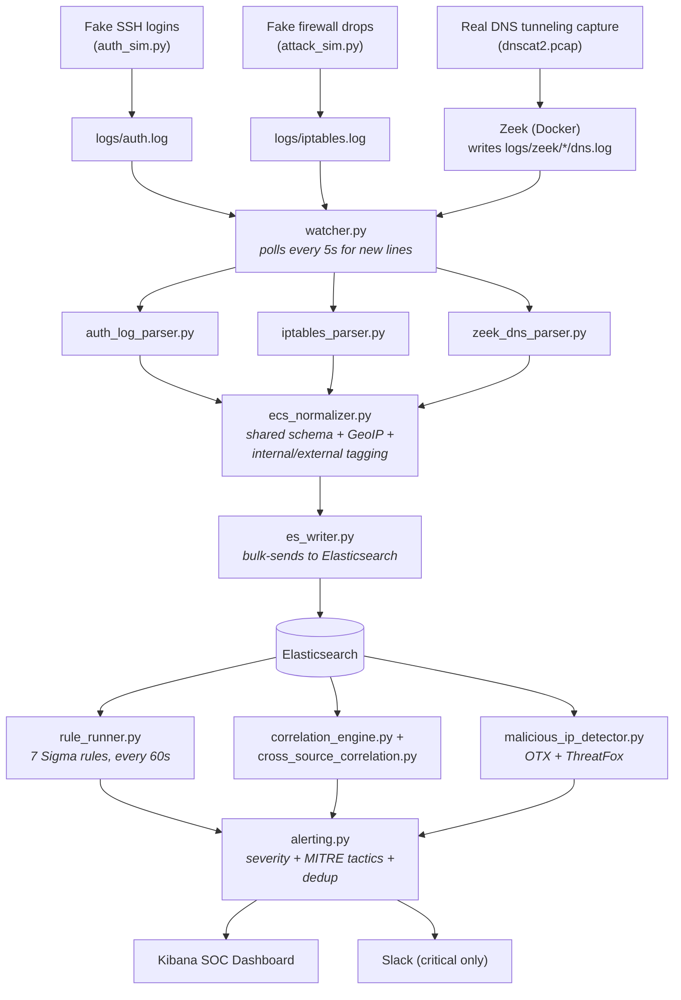
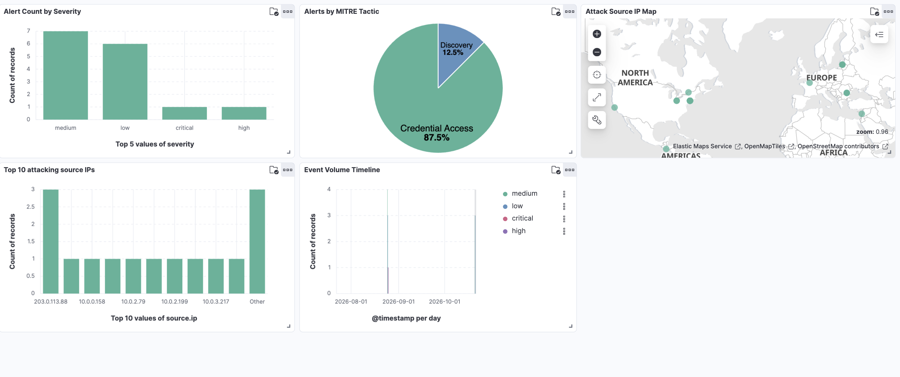
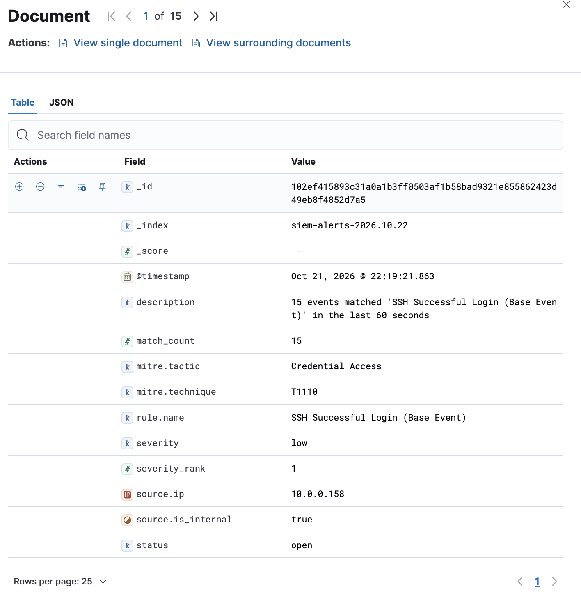
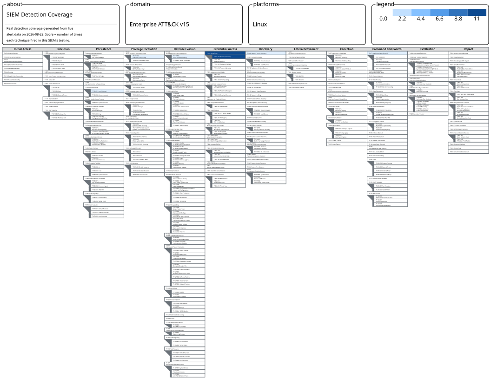

# SIEM — Threat Detection & Correlation Engine

A full-stack Security Information and Event Management (SIEM) system built from scratch — ingesting real and simulated security events, detecting attacks mapped to MITRE ATT&CK, correlating multi-stage threats, and alerting in real time.

> Fire an attack simulation, watch it get detected, and trace exactly how — from raw log line to Slack notification.

---

## What this does

- Ingests **4 log sources**: Linux SSH auth logs, iptables firewall logs, real Zeek network captures, and the CICIDS-2017 labeled attack research dataset (1.5M+ events total)
- Normalizes everything into a shared **ECS (Elastic Common Schema)** format via 4 custom parsers, so detection rules never care which source an event came from
- Detects **9 attack patterns** mapped to MITRE ATT&CK, using 3 different detection strategies:
  - **Single-event** Sigma rules (SSH brute force, port scans, account creation, sudo escalation, DNS tunneling, web attacks)
  - **Multi-event correlation** (brute force → successful login)
  - **Cross-source correlation** (port scan + brute force from the same IP — a real recon-then-attack kill chain)
- Matches live traffic against **real threat intelligence** (AlienVault OTX, Abuse.ch ThreatFox)
- Scores, deduplicates, and routes alerts — critical severity pings **Slack** in real time
- Visualizes everything in a **Kibana SOC dashboard** and a data-driven **MITRE ATT&CK Navigator** coverage map

---

## Architecture


---

## Tech Stack

| Layer | Tools |
|---|---|
| **Ingestion** | Elasticsearch, Logstash, Filebeat, Docker Compose |
| **Data sources** | CICIDS-2017 dataset, Zeek, custom Python log generators |
| **Detection** | Sigma rules, pySigma, custom Python correlation engines |
| **Threat Intel** | AlienVault OTX, Abuse.ch ThreatFox |
| **Alerting** | Slack webhooks |
| **Visualization** | Kibana, MITRE ATT&CK Navigator |
| **Language** | Python 3.10+ (pytest for testing) |

---

## Screenshots

| SOC Dashboard | Alert Detail | MITRE ATT&CK Coverage |
|---|---|---|
| | |  |

---

## Quick Start

```bash
git clone <your-repo-url> SIEM && cd SIEM

# 1. Start the ELK stack
docker compose up -d

# 2. Set up Python
python3 -m venv venv && source venv/bin/activate
pip install elasticsearch==8.14.0 pandas requests OTXv2 python-dotenv pytest

# 3. Add your API keys
cp .env.example .env   # then fill in OTX_API_KEY, THREATFOX_AUTH_KEY, SLACK_WEBHOOK_URL

# 4. Register schemas + build threat intel
python3 pipeline/index_template.py
python3 pipeline/alerts_index_template.py
python3 pipeline/build_mitre_mapping.py
python3 pipeline/otx_client.py
python3 pipeline/threatfox_client.py
python3 pipeline/sigma_converter.py

# 5. Start ingestion
./start_project.sh

# 6. Verify everything works end to end
python3 pipeline/validate_all_rules.py
# → RESULT: 10/10 detections fired successfully

# 7. Run the full attack demo
python3 pipeline/demo_attack.py
```

Full setup guide with troubleshooting: [`docs/SIEM_COMPLETE_GUIDE.md`](docs/SIEM_COMPLETE_GUIDE.md)

---

## Project Structure

```
SIEM/
├── docker-compose.yml       # ELK stack definition
├── generators/              # Log generators (background noise + on-demand attacks)
├── parsers/                 # Format-specific parsers + ECS normalizer
├── pipeline/                # Ingestion, watcher, alerting, threat intel, Sigma conversion
├── engine/                  # Correlation and threat-intel detection logic
├── rules/                   # 8 Sigma detection rules
├── tests/                   # Automated parser unit tests
└── docs/                    # Full documentation guide + screenshots
```

---

## 🧪 Testing

```bash
pytest tests/ -v                          # unit tests for all parsers
python3 pipeline/validate_all_rules.py    # full end-to-end detection validation
```

---
